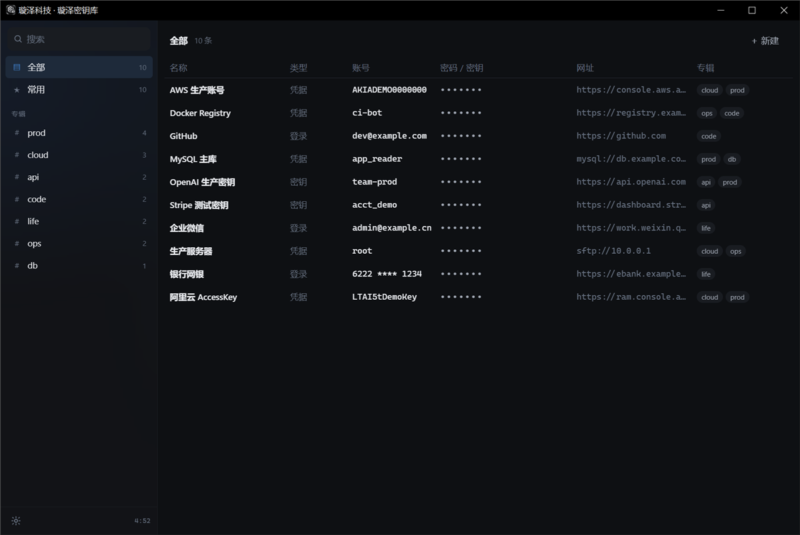
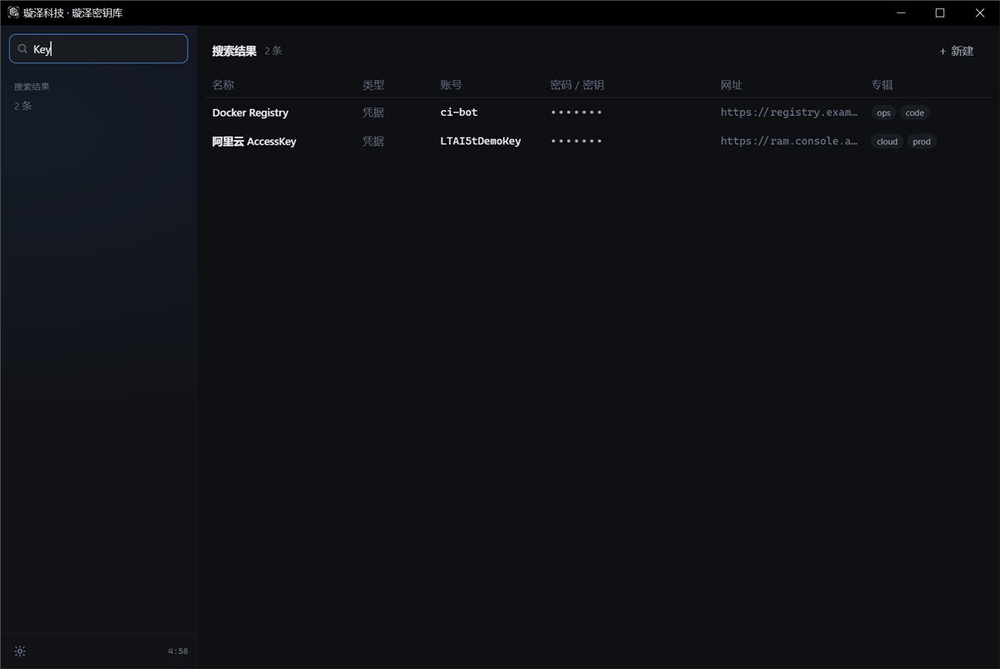
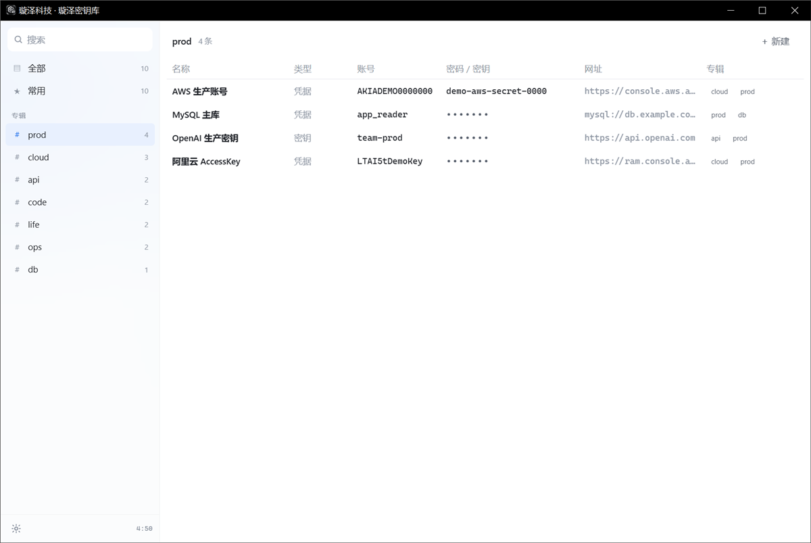

# 璇泽密钥库 · Xuanze Password Manager

[](LICENSE)
[](https://www.rust-lang.org/)
[](https://tauri.app/)
[]()
[]()

**A fast, local-first password manager for Windows.**
Rust core + Tauri v2 shell. Argon2id + AES-256-GCM. No cloud, no account,
no telemetry — everything stays on your machine and is bound to it.

> 一个**轻量、极快**的本地密码管理器，面向日常使用。Rust 核心 + Tauri v2 桌面壳。
>
> 打开要快、搜到要快、复制要快、锁上要快。同时该有的安全一点不打折。
>
> 网站密码、API 密钥、访问令牌、数据库口令、SSH 私钥，都放这一个文件里。

---

## 这是什么

**一个打开就能用的本地密码管理器。** 下载、安装、设一个主密码，立刻开始存东西。
没有注册流程，没有订阅，没有工作区概念，没有需要跳过的引导页。

装在自己电脑上，双击打开，输入主密码，找到条目，复制，切回原来的窗口粘贴。
这个动作五秒钟完成。浏览器自带的密码管理器存不了 API 密钥、数据库口令、
SSH 私钥；笔记软件存这些等于把明文摊在桌面上。这个产品补的就是这一段。

**第一版即正式版。** 建库、加密、检索、复制、自动锁定、改主密码、
深浅主题、Excel 导入导出，全部可用。没有标注「即将推出」的灰色按钮。

> ### 先说清楚一件事：库文件绑的是硬件，不是机器名
>
> `vault.xzvlt` 只能在这一台**硬件**上打开。换主板、换系统盘之后打不开，
> 密码正确也没用 —— 它挡的是「文件被拷走」这一类事故。
>
> **但下面这些都不影响：重装系统、清空 `%APPDATA%`、改计算机名、格式化新装。**
> 绑定材料跟着文件走（用主板身份封在文件里），系统重装完把库文件放回去就能开。
>
> **备份也不是明文了。** 「导出」出来是一个 `.xzbak` 文件：里面是完整 Excel，
> 但外面用 Argon2id + AES-256-GCM 包了一层，**磁盘上从头到尾不出现明文表格**。
> 换电脑时把 `.xzbak` 拷过去，在新机器上建好库，「导入」它就行。
>
> ```text
> 备份：设置 → 备份 → 导出备份       得到一个 .xzbak（密文）
> 迁移：新机器装好 → 设主密码建库 → 设置 → 备份 → 导入 → 选那个 .xzbak
> ```
>
> 建议每月导出一次，重要改动后立刻一次，保留最近几份。
> 完整流程见「[备份与迁移](#备份与迁移加密备份的路线)」。

### 性能

| | 本产品 | 同类 Electron 实现 |
|---|---|---|
| 安装包 | **2 MB** | 80–150 MB |
| 装完占用 | **5 MB** | 200 MB 以上 |
| 冷启动 | **1 秒内** | 2–5 秒 |
| 搜索 1 万条 | **1 ms 内** | 几十毫秒 |
| 取一条密钥 | **44 ns** | — |

差距来自架构，不是调优：Rust 直接编译成机器码，界面复用系统自带的 WebView2，
不打包浏览器内核。省下的是「打开它」这个动作的成本 —— 一个不需要犹豫就能点开的
密码管理器，才会被真正用起来。

### 存什么

网站密码、API 密钥、访问令牌、数据库连接串、SSH 私钥、证书、银行卡，
以及低频账号。全部落在同一个加密文件里。每条可以带若干自定义字段
（单条 512 个以内，每个值 64 KiB 以内），标记为敏感的字段按主密钥级别加密。

---

## 安全

### 库文件离开这台机器，打不开

三道防线，强度递减，但前两道是硬的：

**一、主密钥派生绑定本机（核心防线）。** 除主密码外，还混入本机 DPAPI 封存的
32 字节随机串、机器名与系统卷序列号。把 `vault.xzvlt` 拷到另一台电脑、发给他人、
上传网盘，缺少原机器上的绑定材料，主密钥算不出来，解密无法完成。

`machine.bind` 由 DPAPI 用当前 Windows 用户的密钥加密：换台机器、换个账户都解不开。

**说准确一点：** 这道防线的边界是「同一台机器、同一个 Windows 账户」。
它不是密码学意义上的硬屏障 —— 那 32 字节是 DPAPI 的**用户级**加密，
攻击者一旦能以你的账户运行代码（不需要管理员），就能解开 `machine.bind`，
拿回那 32 字节，再配合完全公开的机器名与卷序列号还原 pepper。
所以在那种前提下，这层保护**退化为「文件要被拿走，得连 `machine.bind` 一起拿」**。

要防住「同账户代码」这一层，靠的不是这里 —— 见下方结论。

**二、Argon2id + AES-256-GCM。** 即使有人复制了同一台机器的绑定材料，
仍需面对每次尝试约 0.4 秒的派生成本（256 MiB × 4 轮）与 GCM 的完整性校验。

**三、库标识登记表（防误开，不是安全边界）。** 程序会拒绝打开未经登记的库文件。
这一层的作用是挡住「点错了别人的 .xzvlt」，以及减少用户被钓鱼文件误导的机会。
它在安全意义上不是硬屏障 —— 登记表本身是 `%APPDATA%` 下的文件，
有本机写权限的人可以修改。已知这一点，所以不把它当作防线宣传。

**结论：三道加起来，能保证的是这一句 ——**

> 只拿走 `vault.xzvlt` 这一个文件，解不开。

再往细一层，取决于攻击者拿到什么：

| 攻击者手里有什么 | 结果 |
|---|---|
| 只有 `vault.xzvlt` | 解不开 |
| `vault.xzvlt` + 机器名与卷序列号（都是公开值） | 解不开，还缺那 32 字节 |
| `vault.xzvlt` + `machine.bind`，但不在你的账户下 | DPAPI 解不开，仍解不开 |
| `vault.xzvlt` + `machine.bind` + 能在你的 Windows 账户下运行代码 | **能解开**：顺走 32 字节，之后离线爆破主密码 |

最后一行是本产品明确不防的边界 —— 那已经等于「这台机器失守」，
超出本地密码管理器的能力范围。我们不把它包装成密码学屏障。

### 库文件只在这一台硬件上：哪些打不开，哪些没事

把边界说准一点。**打不开的是「那个 `.xzvlt` 文件」，而且只有换硬件才会打不开。**

| 发生了什么 | `vault.xzvlt` | 数据 |
|---|---|---|
| 改计算机名 | **能开**（名字不参与绑定） | — |
| 重装系统（同一台机器） | **能开**（绑定材料在文件里） | — |
| 格式化 C 盘重装 | **能开** | — |
| 清空 `%APPDATA%` | **能开** | — |
| 换主板 | 打不开 | 用之前导出的 `.xzbak` 恢复 |
| 换系统盘 + 重装 | 打不开 | 同上 |
| 换电脑 | 打不开 | 同上 |
| 只把 `vault.xzvlt` 备份到网盘 | 那份备份在别的机器上打不开 | 备份要存 `.xzbak` 才有用 |
| 忘了主密码 | 打不开 | 之前导出过的 `.xzbak` 仍然可以导入（要输的是**新库**的密码 + 当时设的备份密码） |

这是这个产品**从一开始就选定**的形态：库文件不出这台机器，也不接受在别处被还原。

**为什么这么选。** 密码管理器最常见的失效场景不是「算法被破」，
是「备份文件流出去」。一个能在任何一台机器上解开的库，它的安全性上限
就等于主密码的强度，跟你把文件发给谁无关。我们不想把产品的安全
建立在这一个变量上。

**代价同样明确：** 换硬件之后要主动做一次「导出 → 导入」。
这不是隐藏成本，是这条设计路线的账。要不要接受，看下面三点：

1. 这台机器是你长期存放凭据的那台，不会频繁换、不会频繁重装 —— 那这笔账基本不用付
2. 换硬件之前，你知道要做的是**导出一次**（不是备份 `%APPDATA%`，
   那个目录里的材料换机器也用不了）
3. 你能维持「定期导出」这个习惯，哪怕只是每月一次

**「恢复路径」是本产品的正式功能，不是补丁。** 库文件本身不提供跨硬件恢复，
这是刻意的；加密备份补上了这一块 —— 而且是对称的：导出多少字段，
导入就还原多少字段，含自定义字段与全部时间戳。

### 备份（加密）

设置 → 备份 → **导出备份**，得到一个 `.xzbak` 文件。

里面是一份完整的 xlsx（按专辑分工作表，能被 Excel 打开），但**外面包了一层
我们自己的加密**：Argon2id 64 MiB × 3 派生 + AES-256-GCM。
磁盘上从头到尾不出现明文表格。

**为什么不直接用 Excel 的密码保护**：OOXML 那套（ECMA-376）被 hashcat
一类工具穿得很透，几小时到几天的事。这里要保护的是「全部账号密码」，
不能拿一个已知能被跑穿的锁去锁它。

**两个密码，各有各的用处：**

| 密码 | 干什么 |
|---|---|
| 主密码 | 证明操作者是你本人。导出 / 导入 / 改密码 / 开关免密码模式都要它 |
| 备份密码 | 加密这个 `.xzbak` 文件。可以设成和主密码一样，也可以另设 |

备份密码**不能留空** —— 留空就等于没加密。

**免密码模式不豁免主密码那一步**：省的是每次启动的输入，
不该顺带把「一次性拿出全部数据」也变成免检。

**表格格式固定，导入导出对称：**

| 位置 | 含义 |
|---|---|
| 每张工作表 | 一个专辑（左侧栏里的那个标签），另有一张「全部」 |
| 第一行 | 表头，共 12 列：名称 / 类型 / 账号 / 密码·密钥 / 网址 / 专辑 / 备注 / 更新时间 / 自定义字段 / 创建时间 / 过期时间 / 使用次数 |
| 列怎么对位 | **按列名对位，不按位置**。列顺序可以调、中间可以插自己的批注列，只要「名称」列在 |
| 认不出表头 | 整张表跳过，不去猜列序 —— 猜错会把密码塞进用户名 |
| 自定义字段列 | `字段名=值`，多个用 `; ` 分隔；字段名前的 `!` 表示这个字段是敏感的 |
| 空单元格 | 省略了也不影响 —— 读取按每个单元格自己的地址定位，不会整行左移 |

导入时接受两种文件：`.xzbak`（要备份密码）和普通 `.xlsx`（直接读，
方便别人给你一份手工整理的表）。「名称 + 账号」都相同的条目会被跳过，
同一个文件可以重复导入。导入失败的条目会把原因报出来（最多 10 条），不会静默少条。

> **`.xzbak` 里的 xlsx 认的是这套表头。** 从 1Password / Bitwarden 导出的 xlsx
> 认不了 —— 那是它们的列名。需要从别处迁移，先把列名改成上面那 12 个
> （只保留前 9 列也能导入，缺的列按空处理）。用 Excel 打开、改一格、再保存
> 也没问题：文件会变成共享字符串表，读取端认这个。

### 外部工具无法读取

格式完全公开（[docs/FORMAT.md](docs/FORMAT.md)，可自行实现读取器），
但**离线读取**内容仍需要主密码与目标机器的绑定材料。格式透明，数据不透明。

**这句话的边界必须说清楚：它只对「静置在磁盘上的文件」成立。**

软件已解锁、正在运行的那段时间，前端与 Rust 之间走的是 Tauri IPC，
而 Tauri v2 的 IPC **不校验调用方身份** —— 它假定同一台机器上的其它进程是干净的。
也就是说，在库处于解锁状态时，一个能注入 WebView2 或构造 IPC 请求的本地进程，
可以调用 `entry_reveal` 读到明文。

这个前提藏在所有本地密码管理器的底层，我们选择把它写出来而不是略过：
**本软件信任「已登录的这个 Windows 用户」运行的所有程序。**

**正因为承认这一点，几条「敏感动作」在 IPC 层做了收紧，而不是靠界面自觉：**

| 动作 | 收紧方式 |
|---|---|
| 导出备份 / 导入 | 必须重新验证主密码，且**判定方式是重新派生再和内存主密钥做常量时间比对**（免密码模式也不豁免）。不是「生成一个校验块再校验它自己」那种自证 |
| 改主密码 / 开关免密码模式 | 同上，必须证明知道主密码 |
| 写回库文件 | 路径由后端决定，IPC 上**没有路径参数**；且目标位置已存在别的库或别的文件时拒绝覆盖 |
| 打开库 | 路径同样由后端决定，前端没有「打开哪个文件」的发言权 |
| 改自动锁定时长 | 要求已解锁。锁着的时候把时长拉长，等于替下一个人关掉一把锁 |

要改变「同账户程序可信」这个前提，需要 IPC 层的身份挑战机制（如一次性 token），
当前版本没有做。

如果你所处的环境本身就不可信（共用电脑、来源不明软件较多），
建议把闲置锁定调短（设置里可以选 1 分钟），用完立刻锁定。

### 防护清单

| 威胁 | 处理 |
|---|---|
| 库文件被拷走 | 主密码 + 硬件绑定双重门槛，缺一不可 |
| 文件被篡改 | 71 字节文件头整体作为 AAD，任一位改动导致认证失败 |
| 换硬件暴力破解 | pepper 里的随机串封在文件内、用主板身份加密封装；换板/换盘解不开。**但同账户代码 + 知道你那台机器的 SMBIOS UUID 可以解开**，见上节 |
| 备份文件泄露 | 导出即加密（Argon2id 64 MiB × 3 + AES-256-GCM），磁盘上没有明文表格 |
| 敏感数据进入日志 | 密钥材料统一走 `SecretBytes`，`Debug` 仅输出长度（含免密码模式封存的主密钥） |
| 内存残留 | `zeroize` 全量清零，锁库时主动擦除；导出的明文表格在内存里用 `Drop` 逐格擦 |
| 通过界面开启开发者工具 | 发布版编译期不含 devtools；另拦截 F12、`Ctrl+Shift+I`、`Ctrl+U` 与右键菜单 |
| 剪贴板长期驻留 | 敏感内容 15 秒、普通内容 60 秒后自动清除；校验指纹避免误清用户内容；清除失败会保留指纹重试，而不是当作已清 |
| 误建新库覆盖旧库 | 「本机有没有库」问后端（登记表 + 文件存在）；后端保存前再挡一道：目标是别的库时拒绝写入 |
| 恶意 Excel | 单个 zip 成员解压上限 64 MiB（防解压炸弹）；自定义字段列与段数设上界；行数上限 20 万 |
| 畸形库文件 | 逐字节篡改、长度字段极值、全长度截断、随机字节都有测试守着；任何路径只返回错误，不 panic |
| 超大库文件 | 打开前先查大小，超过 1 GiB 直接拒绝，不把内存交出去 |

**不在防护范围内：** 主密码被录屏或键盘记录；已取得管理员权限的进程读取内存；
开启免密码模式后本机进入库不再需要主密码（备份导出仍要求输密码）；
**删除条目后旧密文仍可能留在磁盘空闲区** —— 保存是整份重写 + 替换文件，
旧文件的数据块归系统回收，本软件不做磁盘擦除。若磁盘会落入他人之手，
应在删改敏感条目后对整盘启用 BitLocker，而不是指望本软件抹掉痕迹。

### 免密码模式

设置里有一个开关。**默认关闭。**

开启后：在这台电脑上启动、关闭都不再要求输入密码。
关闭后：一切恢复原样，每次启动都要输主密码。

**它不是「把主密码改成空」。** 库文件本身没有任何变化，仍然用
**完整主密码 + 本机绑定**加密。开启时做的是：

1. 你输一次主密码，验证通过
2. 主密钥用 Windows DPAPI 封存，写到 `%APPDATA%\cn.xuanze.vault\auto_unlock`
3. 下次启动时，程序用 DPAPI 解开这份封存，直接拿主密钥开门

所以边界很清楚：

| 场景 | 结果 |
|---|---|
| 这台电脑、这个 Windows 账户 | 直接进，不问密码 |
| 换成别的 Windows 账户 | DPAPI 解不开，退回要密码 |
| 库文件拷到别的电脑 | 打不开（主密码 + 硬件绑定都没变） |
| 把 `auto_unlock` 一起拷走 | 还是解不开（DPAPI 绑账户，不认文件搬家） |
| 重装系统 | 封存丢了，退回要密码（库本身还能开，见上文） |
| 关闭免密码模式 | 删掉封存，下次必须输密码 |

**为什么这样做而不是真的去掉密码：** 一个能随手复制、任何人拿到都能开的库，
本质上已经不是加密文件了。免密码模式解决的是「每次输入很烦」，
不是「不要密码」—— 这两件事不该用同一个办法解决。

**开启它，代价是什么。** 封存在本机的主密钥，同一个 Windows 账户下的
任何程序都能解开。所以在开启期间：**本机任何程序都能不输密码进你的库**，
启动时那道「证明你是你」的门槛在这台机器上被撤掉了。这是这个模式的直接后果，
不是遗漏 —— 所以开启前会要求你勾选确认，并且：

- 备份导出 / 导入**仍然要求输入主密码**。这两个动作涉及「把全部数据拿出来」
  和「往库里写数据」，不跟着这个开关放行
- 改主密码会自动关闭免密码模式（旧密钥失效了），需要重新开启一次

需要的是「打开就能用」但又不想撤掉本机门槛的话，把自动锁定时间调短
比开这个模式更划算。

---

## 适用范围

### 日常个人使用：可以，这是设计目标

一个人的密码、API 密钥、凭据，由一个人保管和使用 —— 这是本产品唯一的场景，
也是所有取舍的出发点。

**它足够日常用。** 装完即用，冷启动一秒内，搜索一万条一毫秒内，
复制密钥 44 纳秒。不用理解任何一个密码学名词也能用起来。

**前提是接受一件事：库文件只在这台硬件上。** 这不是限制，是这条产品线
成立的条件。数据本身可以走「导出备份 → 导入」搬走，所以日常用起来不需要
惦记换机的事；真正需要养成的习惯只有一个——定期导出（下一节）。

### 备份与迁移：加密备份的路线

这是本产品**唯一**的用户侧备份方案，也是备份功能存在的首要理由。
完整手册见 [docs/BACKUP.md](docs/BACKUP.md)（含字段级别的还原清单与常见误区）。

**建议每月导出一次、重要改动后立刻导出一次，并保留最近几份。**

#### 一、日常备份

```
设置 → 备份 → 导出备份
  ↓
输主密码（证明是你）+ 设一个备份密码（给这个文件上锁）
  ↓
选一个位置（移动硬盘、U 盘、网盘都行）
  ↓
得到一个 .xzbak —— 密文，2 MB 上下
```

三点须知：

1. **文件本身是密的。** 里面是完整 Excel，但外面用 Argon2id + AES-256-GCM
   包了一层。拿到文件的人没有备份密码，看到的就是一堆随机字节。
2. **备份密码别忘。** 忘了它这个文件就打不开 —— 我们没有后门。
   可以设成和主密码一样（少记一个），也可以另设一个（泄露时影响面更小）。
3. **它就是你的灾备。** 换硬件、换电脑、硬盘坏了 —— 只要这份 `.xzbak` 还在，
   数据就能通过「导入」原样回来。

#### 二、换硬件 / 换电脑：三步

全程在界面上点，不需要命令行，也不需要碰 `%APPDATA%`。

| 步骤 | 在哪 | 做什么 |
|---|---|---|
| 1 | 旧机器 | 设置 → 备份 → 导出备份。把 `.xzbak` 拷到新机器（U 盘、网盘都行） |
| 2 | 新机器 | 装好软件，第一次打开照提示设一个主密码 —— 这会建一个**新库** |
| 3 | 新机器 | 设置 → 备份 → 导入，选那个 `.xzbak`，输**新库**的主密码 + 当时的备份密码 |

导入会还原：名称、类型、账号、密码·密钥、网址、专辑、备注、
自定义字段（含「敏感」标记）、创建时间、更新时间、过期时间、使用次数。

不还原的只有一样：**库本身**。新库有新的库标识、新的硬件绑定、新的文件。
旧的 `vault.xzvlt` 迁移完之后就不需要了（它是绑定旧硬件的密文，留着也打不开）。

> **如果只是重装系统（硬件没换），不需要走这三步。**
> 库文件的绑定材料就存在文件里，系统装好、软件装好、把 `vault.xzvlt`
> 放回 `%APPDATA%\cn.xuanze.vault\` 就能直接打开 —— 连导入都不用。

#### 三、主密码忘了

导出过的 `.xzbak` 仍然可以导入到新库 —— 导入时输的是**新库**的密码
和你当初设的备份密码。也就是说：忘了主密码不等于数据没了，前提是导出过。
没导出过就真的没有了，我们没有任何后门可以恢复。

> 有人会问：既然有导出，为什么还要硬件绑定？
>
> 因为两者防的不是同一件事。硬件绑定防的是「库文件被动带走」——
> 网盘误同步、U 盘丢失、发错文件，这类事故不需要攻击者做任何事。
> 导出是**你主动、明确、知道在做什么**地把数据拿出来，而且拿出来的还是密文。
> 一个是防意外，一个是做备份，不冲突。
>
> 想把日常体验做到「不用输密码」，同时保留库文件的高保护，
> 用设置里的「免密码模式」——它封存的是本机可解的主密钥，
> 不改变库文件本身的加密强度（代价见上文那一节）。

### 关键技术能力与许可授权，是两件事

**技术上：** 加密强度与文件格式足以存放生产环境密钥。AES-256-GCM、
Argon2id、71 字节 AAD、零内存残留 —— 这些不看使用场景。

**许可上：** PolyForm Noncommercial 1.0.0 **不允许商业用途**，
且 Noncommercial 覆盖「你所在的组织」。也就是说：**在公司电脑上安装它、
用它存公司的密钥或凭据，属于违反许可**，需要单独购买授权。

技术上能做的，许可上不一定允许。这一条请按许可来，不按技术来。
另外本产品也不具备团队协作能力：无共享库、无角色权限、无审计日志。

### 几个常被提出的质疑

产品公开后，收到的批评里有几条判断成立、也有几条高估了风险。这里逐条回应，
你可以自己去代码里核对。

**「机器绑定不增加熵，所以是无效的。」**

前半句对，后半句错。

那 32 字节是 `BCryptGenRandom` 生成的，做字典攻击无从下手。
硬件标识（v2 用机器名与卷序列号，v3 用主板 SMBIOS UUID）的作用不是贡献熵，
而是**防止那份材料被挪用到别的机器上**。强度来源是
「主密码 + 256 bit 随机串」，不是「主密码 + 机器名」。

真正成立的说法是另一句：这层挡不住「能在你的 Windows 账户下运行代码、
并且知道你那台机器硬件标识的人」。这一点上文已明写，没有含糊。

**「既然要定期导出，机器绑定就是多余的。」**

两者防的不是同一件事，见「[备份与迁移](#备份与迁移加密备份的路线)」一节。
简单说：硬件绑定防「文件被动带走」，备份是「你主动留一份」。
而且 v1.0.0 之后，导出的东西本身也是密文 —— 备份不再制造新的明文副本。

**「这只是在用安全感换可用性风险。」**

可用的替代方案是「不绑定硬件」，代价是：任何拿到 `.xzvlt` 的人，
都能在自己的机器上不限时间、不限次数地离线爆破主密码。
对一个主密码可能是「名字+生日」的现实用户群来说，那才是更大的风险。

**「作为日常个人密码库不建议。」**

我们不同意，但要分清它说的「建议」是哪一层。

如果指的是「怕丢数据」—— 那是备份问题，加密备份就是为它准备的，见上文。
如果指的是「换硬件不方便」—— 那是产品形态，README 从头到尾都在说这件事。

我们不假装它是适合所有人的工具：需要跨设备、需要异地容灾的人应该用
KeePass 或 Bitwarden。但「换硬件不方便」不等于「不能日常用」，
这两件事被混为一谈过很多次。

**「导入导出会丢自定义字段。」**

这条曾经成立，已经修掉了。上一版 `row_to_entry` 只读前 7 列，自定义字段
在导入时被丢弃，`created_at` / `expires_at` 也会重置 —— 那确实是缺陷，
不是取舍。

现在导出 12 列、导入按列名对位，自定义字段（含「敏感」标记）用可逆编码
带 `!` 前缀与 `\` 转义，往返一次逐字段相等。这一点有测试盯着：
`entry_survives_export_then_import` 把一条带自定义字段、三个时间戳、
使用次数的条目走完整条「表格 → 条目」的路，逐个字段比对。
另外三条跟它一起修的：

- **用 Excel 改一格再保存不会串列。** 读取端按每个单元格自己的地址
  （`r="C7"` 里的 `C`）定位，空单元格被省略也不会整行左移；顺带认
  Excel 重存后产生的共享字符串表。
- **导入失败不再静默。** 被 `validate` 挡下的条目会带着行号和原因报出来。
- **编辑条目不会清空敏感自定义字段。** 前端拿不到敏感值，空串按「用户没碰」
  处理，而不是「清空」。

---

### 明确不做

**云同步与浏览器扩展。** 见 [ROADMAP](docs/ROADMAP.md)。

**不防御已失陷的本机环境。** 若攻击者已取得本机管理员权限，可读取进程内存，
任何本地密码管理器都无法抵御。本产品防御的是文件被拷走、介质丢失、
设备被他人接触这三类情形。

**项目处于早期，持续维护。** 遇到问题请在
[Issues](https://github.com/XuanzeNetDev/xuanze-password-manager/issues) 提出，
会持续跟进修复。

---

## 界面

下面这些图都是从真实软件里截的，不是画的原型图。

### 锁屏

打开软件第一眼看到的就是这个。一个输入框，输密码，进库。

中间那行小字平时是空的，有情况才冒出来——比如「密码不对」，
或者你出门忘了锁，「闲置超时，已自动锁定」也会写在这儿。
底下那句是提醒：密码不上传、只存在这台电脑上；忘了密码只能靠导出的 Excel
恢复数据，所以建议尽早导出一次。

背景那片青色和紫色的光斑会慢慢漂，不快，就是让静止的画面别那么死。


### 主界面

左边一列是专辑，右边是表格。所有条目摊开在一张表里，名称、类型、账号、
密钥、网址、专辑，横向一排，眼睛从上往下扫一遍就够了。

这里跟多数密码管理器不一样的地方：它们通常给你「列表 → 点进详情 → 编辑」三步。
我们省掉「点进详情」这一步——数据本来就是表格形状的，摊开看最快。
选中一行直接按 `Enter` 复制密钥；要改内容点行尾的铅笔图标，或在空窗里按 `Ctrl+N`。

左边专辑是从标签自动长出来的。你给条目打上 `prod`，`prod` 就出现在左边，
不用提前建目录，也不用纠结它该放哪个文件夹。



### 查看密钥

密码平时是 `••••••`。点眼睛，那一格当场变成明文。

注意只有这一格变了，别的行一动没动。有些软件点「显示」会整个列表重排一遍，
眼睛会跟着跳一下，很难受。


### 按专辑筛选

点左边的 `prod`，右边就只剩打了 prod 标签的 4 条。

上边那条横线写着「prod　4 条」，告诉你现在在哪、还剩多少。
再点「全部」就回来了。


### 搜索

输了「Key」，出来两条：Docker Registry 和阿里云 AccessKey。

搜索不看大小写，也不要求你连着打。输 `ol` 就能找到 `OpenAI`，
因为 `O` 和 `L` 在名字里按顺序出现。查名称、账号、网址、标签四项。

**备注不参与搜索，这是有意的。** 备注里经常粘着私钥正文、恢复码、
「数据库口令是 xxx」这种话；把它塞进常驻内存的索引，等于让最敏感的那部分
内容变成可检索的明文结构。索引里只有名称/账号/网址/标签，别的进不去（有单测守着）。

这儿的想法很简单：你记得的往往不是全名，是「那个带 openai 的」，
所以宁可多搜出来几条，也别让你一个字一个字打全。



### 新建条目

名称、类型、账号、密钥、网址、专辑，一行行填下来。

类型选一下——登录、密钥、凭据、笔记、银行卡，不同东西存的地方不一样。

专辑那栏可以直接新建，输完按回车就有。下面还能加自定义字段，
放什么都行，比如「二步验证方式」「bucket 名」「服务器端口」。
标成敏感的字段会跟密钥一样加密。


### 设置

一共七项，没有藏起来的开关：主题、闲置自动锁定、主密码、免密码模式、
备份（导入 / 导出）、退出登录、关于。

闲置锁定在 1 / 5 / 15 / 30 分钟之间选，默认 5 分钟。改完立刻生效，也存得住
（存在后端，清 WebView 数据不会把它冲掉）。

改主密码要输原密码，改完之后旧密码立刻失效，整个库用新密码重新封一遍。
界面里那句「数据用新密码重新封装」不是客套话，是真的全量重加密。

免密码模式、备份这两项的详细规则在前面「安全」一节里，这里不重复。


### 浅色主题

深色是纯黑，浅色是纯白，两边都不透背景。

为什么不透？因为这是看数据的地方。底下要是流光溢彩，读起来会累。
光斑只留在左边专辑栏和锁屏，那边不需要盯字。



### 第一次用

第一次打开没库，就让你设个密码。

只输一次不够，要输两遍，两遍一样才放行。密码至少 8 位。


---

## 快捷操作

| 操作 | 说明 |
|---|---|
| `Ctrl+K` | 聚焦搜索框 |
| `Ctrl+N` | 新建条目 |
| `Enter` | 复制选中条目的密钥 |
| `↑` `↓` | 在列表里上下移动选中 |
| `Ctrl+Shift+1…9` | 直接复制热度榜第 N 条的密钥 |
| `Ctrl+L` | 立即锁库（擦除内存中的密钥与明文） |
| `Esc` | 关闭弹窗 |

输入框内不触发以上快捷键。

另外两项自动行为：闲置超时自动锁库（时长可在设置里调，1–30 分钟）；
复制的密钥在剪贴板里停留 15 秒后自动清除。

新建 / 编辑条目时可以选一个过期日期，到期后列表里的名字旁边会标「已过期」。
导出的表格里也带这一列，换机器之后照样能带回来。

---

## 项目结构

```
.
├── crates/
│   ├── xz-core/      核心库：格式、加密、KDF、索引、搜索、内存擦除
│   └── xz-bench/     性能基准
├── src-tauri/        桌面壳（Tauri v2 命令层 + 自动锁定 + 剪贴板）
├── src/              前端界面（原生 TS，无框架）
└── docs/
    ├── FORMAT.md       二进制格式规范（规范来源）
    ├── BACKUP.md       备份与迁移：导出 / 导入的完整流程
    ├── PERFORMANCE.md  性能报告与优化过程（含被回退的尝试）
    └── screenshots/    界面截图
```

## 构建

```bash
# 只跑核心库测试（不需要 Tauri 环境）
cargo test -p xz-core

# 性能基准
cargo run --release -p xz-bench


# 桌面应用（需要 WebView2 与 Tauri CLI）
cargo tauri dev
cargo tauri build
```

## 状态

**v1.0.0** —— 格式、核心库、桌面壳都已稳定。90 项测试全绿（含畸形输入、
导入导出逐字段往返、v3 绑定块、加密备份容器），`cargo clippy -D warnings` 干净，
安装包 2 MB 可正常安装运行。

**能用的：** 建库、解锁、增删改查、搜索、专辑筛选、复制、自动锁定、
改主密码、深浅主题、Excel 导入导出、过期时间标记。

**后续版本方向：** 全局热键（在任意程序内唤出搜索）、模拟键盘输入（绕开剪贴板
历史工具）、TOTP。排期见 [ROADMAP.md](docs/ROADMAP.md)。云同步与浏览器插件
不在计划内。

开发过程中实测发现并已修复的几个界面问题，记在这里免得别人再踩：

1. **WebView2 在高 DPI 下把窗口尺寸当成物理视口**，150% 缩放时页面只填满窗口的 2/3。
   修法见 `src-tauri/src/lib.rs` 的 `setup`。
2. **模态框底部的保存按钮会被顶出可视区**，因为弹窗自己滚又限高。
   改成头/脚固定、只有主体滚（`src/style.css` 的 `.panel`）。
3. **新建库后没有立即落盘**，用户关窗口就丢数据。现在建库成功立刻保存。
4. **Tauri 的同步命令在主线程执行**，建库那几秒 Argon2 会把窗口冻住，
   Windows 弹出「程序未响应」。改成 `async` + `spawn_blocking`。
5. **`z-index` 漏了就让背景层盖住整个界面**，表现是「纯色背景不生效」。
   `#app` 必须建独立层叠上下文。

---

## 构建注意

`cargo build` 直接编会在二进制里留下 dev URL（`tauri-build` 只要看到 `tauri.conf.json`
有 `devUrl` 就设 `cfg(dev)`，与构建 profile 无关）。正式构建请走 Tauri CLI 并覆盖配置：

```bash
cargo tauri build --config '{"build":{"frontendDist":"../dist","devUrl":null}}'
```

## 许可

**PolyForm Noncommercial 1.0.0**。见 [LICENSE](LICENSE)。

简单说：源代码开放，你可以自由查看、修改、自己使用，用于个人学习、研究、
非营利组织都没问题；**但不得用于商业用途**，也不能把修改后的版本当商业产品
分发或销售。

**注意「商业用途」的界定比直觉宽。** PolyForm Noncommercial 里的 Noncommercial
覆盖你所在的组织：**在公司电脑上安装它、用它存公司的密钥或凭据，也算商业用途**，
需要单独购买授权。个人自己用、个人项目用都没问题。

换句话说：拿它当私人密码库可以；拿它当公司生产环境的凭据存储不行。

为什么要开源：密码管理器的安全性不该建立在「相信作者」之上。算法、密钥派生、
文件格式全部可查、可审、可复现——这样安全性才是能被验证的，而不是被宣称的。