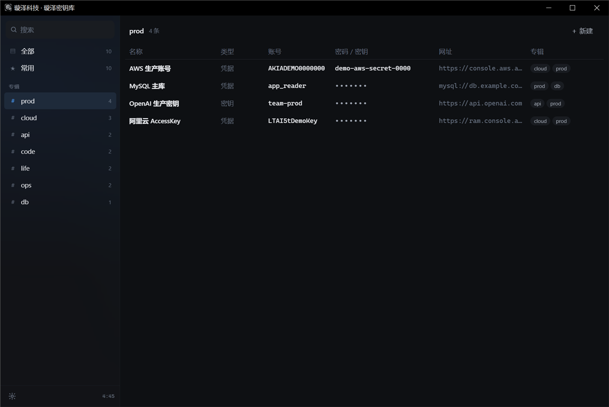

# 璇泽密钥库 · Xuanze Password Manager

[](LICENSE)
[](https://www.rust-lang.org/)
[](https://tauri.app/)
[]()
[]()

**A fast, local-first password manager for Windows.**
Rust core + Tauri v2 shell. Argon2id + AES-256-GCM. No cloud, no account,
no telemetry — everything stays on your machine and is bound to it.

> 一个**轻量、极快**的本地密码管理器，面向日常使用。Rust 核心 + Tauri v2 桌面壳。
>
> 打开要快、搜到要快、复制要快、锁上要快。同时该有的安全一点不打折。
>
> 网站密码、API 密钥、访问令牌、数据库口令、SSH 私钥，都放这一个文件里。

---

## 这是什么

**一个打开就能用的本地密码管理器。** 下载、安装、设一个主密码，立刻开始存东西。
没有注册流程，没有订阅，没有工作区概念，没有需要跳过的引导页。

装在自己电脑上，双击打开，输入主密码，找到条目，复制，切回原来的窗口粘贴。
这个动作五秒钟完成。浏览器自带的密码管理器存不了 API 密钥、数据库口令、
SSH 私钥；笔记软件存这些等于把明文摊在桌面上。这个产品补的就是这一段。

**第一版即正式版。** 建库、加密、检索、复制、自动锁定、改主密码、
深浅主题、命令行工具，全部可用。没有标注「即将推出」的灰色按钮。

### 性能

| | 本产品 | 同类 Electron 实现 |
|---|---|---|
| 安装包 | **2 MB** | 80–150 MB |
| 装完占用 | **5 MB** | 200 MB 以上 |
| 冷启动 | **1 秒内** | 2–5 秒 |
| 搜索 1 万条 | **1 ms 内** | 几十毫秒 |
| 取一条密钥 | **44 ns** | — |

差距来自架构，不是调优：Rust 直接编译成机器码，界面复用系统自带的 WebView2，
不打包浏览器内核。省下的是「打开它」这个动作的成本 —— 一个不需要犹豫就能点开的
密码管理器，才会被真正用起来。

### 存什么

网站密码、API 密钥、访问令牌、数据库连接串、SSH 私钥、证书、银行卡，
以及低频账号。全部落在同一个加密文件里。自定义字段不限数量，
标记为敏感的字段按主密钥级别加密。

---

## 安全

### 库文件离开这台机器，打不开

三重机制，任一层单独成立都足够：

**一、主密钥派生绑定本机。** 除主密码外，还混入本机 DPAPI 封存的 32 字节随机串、
机器名与系统卷序列号。把 `vault.xzvlt` 拷到另一台电脑、发给他人、上传网盘，
缺少原机器的绑定材料，解密无法完成。

**二、只接受本机创建的库。** 即使拿到一个密码完全正确的库文件，
程序在比对库标识后直接拒绝，不进入密码校验环节。

**三、Argon2id 1 GiB × 3 轮 + AES-256-GCM。** 假定前两层均被绕过，
仍需承担每次尝试约 1.5 秒的派生成本与 1 GiB 内存开销。

### 没有导出功能

数据只能在本软件内查看和使用。这是设计决定：一个可以随时导出为 CSV 的密码管理器，
等于把加密降级为一道附加步骤。需要迁移时，逐条复制是唯一路径。

### 外部工具无法读取

格式完全公开（[docs/FORMAT.md](docs/FORMAT.md)，可自行实现读取器），
但读取内容仍需要主密码与目标机器的绑定材料。格式透明，数据不透明。

### 防护清单

| 威胁 | 处理 |
|---|---|
| 库文件被拷走 | 主密码 + 机器绑定双重门槛，缺一不可 |
| 文件被篡改 | 71 字节文件头整体作为 AAD，任一位改动导致认证失败 |
| 换机器暴力破解 | 派生材料含本机 DPAPI 随机串，异机无法复现；库标识不匹配直接拒绝 |
| 敏感数据进入日志 | 密钥材料统一走 `SecretBytes`，`Debug` 仅输出长度 |
| 内存残留 | `zeroize` 全量清零，锁库时主动擦除 |
| 通过界面开启开发者工具 | 发布版编译期不含 devtools；另拦截 F12、`Ctrl+Shift+I`、`Ctrl+U` 与右键菜单 |
| 剪贴板长期驻留 | 敏感内容 15 秒、普通内容 60 秒后自动清除，并校验指纹避免误清用户内容 |

**不在防护范围内：** 主密码被录屏或键盘记录；已取得管理员权限的进程读取内存；
解锁后 12 小时内凭 Windows 用户身份即可进入（见下节）。

### 解锁票据

解锁成功后，主密钥经 Windows DPAPI 封存写入
`%APPDATA%\cn.xuanze.vault\unlock.ticket`，有效期 12 小时。
在此期间再次打开，跳过 Argon2id，耗时降至毫秒级。

该窗口期内，进入库的凭据是「当前 Windows 用户身份」，不再是「主密码」。
这不构成主密码失效：DPAPI 为用户级加密，解开票据必须先取得该用户身份，
攻击面因而从「持有文件」变为「控制本机账户」—— 后者是所有本地程序的共同上限。

设计动机是可用性：每次等待 1.5 秒的 KDF 会让人放弃使用，而一个不被使用的
密码管理器，实际安全强度为零。

需要更严格策略时，删除 `machine.rs` 中的 `save_ticket` 与 `load_ticket`，
程序即退回「每次打开完整执行 KDF」。改动仅此一处。

---

## 适用范围

**面向个人。** 一个人的密码、密钥、凭据，由一个人保管和使用。这是主要场景，
也是产品设计的出发点。

**可用于工作环境。** 存放生产环境密钥与服务器凭据没有问题，加密强度与文件格式
足以支撑。但本产品不提供团队协作能力：无共享库、无角色权限、无审计日志。
多人协同需要的能力不在范围内。

**不提供云同步与浏览器扩展。** 见 [ROADMAP](docs/ROADMAP.md)。

**不防御已失陷的本机环境。** 若攻击者已取得本机管理员权限，可读取进程内存，
任何本地密码管理器都无法抵御。本产品防御的是文件被拷走、介质丢失、
设备被他人接触这三类情形。

**项目处于早期，持续维护。** 遇到问题请在
[Issues](https://github.com/XuanzeNetDev/xuanze-password-manager/issues) 提出，
会持续跟进修复。

---

## 界面

下面这些图都是从真实软件里截的，不是画的原型图。

### 锁屏

打开软件第一眼看到的就是这个。一个输入框，输密码，进库。

中间那行小字平时是空的，有情况才冒出来——比如「密码不对」，
或者你出门忘了锁，「闲置超时，已自动锁定」也会写在这儿。
底下那句是提醒：密码不上传，忘了就真找不回来了，我们也没有后门帮你重置。

背景那片青色和紫色的光斑会慢慢漂，不快，就是让静止的画面别那么死。


### 主界面

左边一列是专辑，右边是表格。所有条目摊开在一张表里，名称、类型、账号、
密钥、网址、专辑，横向一排，眼睛从上往下扫一遍就够了。

这里跟多数密码管理器不一样的地方：它们通常给你「列表 → 点进详情 → 编辑」三步。
我们直接省掉后两步——数据本来就是表格形状的，摊开看最快。
想改哪一格，点那一格就改。

左边专辑是从标签自动长出来的。你给条目打上 `prod`，`prod` 就出现在左边，
不用提前建目录，也不用纠结它该放哪个文件夹。


### 查看密钥

密码平时是 `••••••`。点眼睛，那一格当场变成明文。

注意只有这一格变了，别的行一动没动。有些软件点「显示」会整个列表重排一遍，
眼睛会跟着跳一下，很难受。


### 按专辑筛选

点左边的 `prod`，右边就只剩打了 prod 标签的 4 条。

上边那条横线写着「prod　4 条」，告诉你现在在哪、还剩多少。
再点「全部」就回来了。



### 搜索

输了「Key」，出来两条：Docker Registry 和阿里云 AccessKey。

搜索不看大小写，也不要求你连着打。输 `ol` 就能找到 `OpenAI`，
因为 `O` 和 `L` 在名字里按顺序出现。名称、账号、网址、标签、备注，全都查。

这儿的想法很简单：你记得的往往不是全名，是「那个带 openai 的」，
所以宁可多搜出来几条，也别让你一个字一个字打全。


### 新建条目

名称、类型、账号、密钥、网址、专辑，一行行填下来。

类型选一下——登录、密钥、凭据、笔记、银行卡，不同东西存的地方不一样。

专辑那栏可以直接新建，输完按回车就有。下面还能加自定义字段，
放什么都行，比如「二步验证方式」「bucket 名」「服务器端口」。
标成敏感的字段会跟密钥一样加密。


### 设置

就四项，没别的：主题、主密码、退出登录、关于。

改主密码要输原密码，改完之后旧密码立刻失效，整个库用新密码重新封一遍。
界面里那句「数据用新密码重新封装」不是客套话，是真的全量重加密。


### 浅色主题

深色是纯黑，浅色是纯白，两边都不透背景。

为什么不透？因为这是看数据的地方。底下要是流光溢彩，读起来会累。
光斑只留在左边专辑栏和锁屏，那边不需要盯字。


### 第一次用

第一次打开没库，就让你设个密码。

只输一次不够，要输两遍，两遍一样才放行。密码至少 8 位。


---

## 快捷操作

| 操作 | 说明 |
|---|---|
| `Ctrl+K` | 聚焦搜索框 |
| `Ctrl+N` | 新建条目 |
| `Enter` | 复制选中条目的密钥 |
| `↑` `↓` | 在列表里上下移动选中 |
| `Ctrl+Shift+1…9` | 直接复制热度榜第 N 条的密钥 |
| `Ctrl+L` | 立即锁库（擦除内存中的密钥与明文） |
| `Esc` | 关闭弹窗 |

输入框内不触发以上快捷键。

另外两项自动行为：闲置超时自动锁库；复制的密钥在剪贴板里停留固定时长后自动清除。

---

## 项目结构

```
.
├── crates/
│   ├── xz-core/      核心库：格式、加密、KDF、索引、搜索、内存擦除
│   ├── xzc/          命令行工具：不装 GUI 也能用
│   └── xz-bench/     性能基准
├── src-tauri/        桌面壳（Tauri v2 命令层 + 自动锁定 + 剪贴板）
├── src/              前端界面（原生 TS，无框架）
└── docs/
    ├── FORMAT.md       二进制格式规范（规范来源）
    ├── PERFORMANCE.md  性能报告与优化过程（含被回退的尝试）
    └── screenshots/    界面截图
```

## 构建

```bash
# 只跑核心库测试（不需要 Tauri 环境）
cargo test -p xz-core

# 性能基准
cargo run --release -p xz-bench

# 命令行
cargo run --release -p xzc -- --help

# 桌面应用（需要 WebView2 与 Tauri CLI）
cargo tauri dev
cargo tauri build
```

## 命令行速览

```bash
xzc init   my.xzvlt --password -
xzc add    my.xzvlt --password - --name "OpenAI 生产 Key" --kind api-key \
                          --secret sk-xxxx --tag api --tag prod
xzc find   my.xzvlt --password - openai
xzc show   my.xzvlt --password - <id> --reveal
xzc export my.xzvlt --password - --out backup.csv
```

`--password -` 表示从环境变量 `XZ_PASSWORD` 读取，避免密码进 shell 历史。

> **注意：`xzc` 建的库和桌面端的库不通用。**
>
> 桌面端建库时，主密钥派生混入了本机 DPAPI 封存的随机串（机器绑定）；
> `xzc` 不绑定机器，派生材料不同。两者算出来的密钥不一样，
> 所以谁建的库谁来开，互相打不开。
>
> 这是有意为之：`xzc` 的定位是「不进 GUI 也能读写、能复现格式问题」，
> 不是桌面端的第二入口。真要把一个库在两个端之间搬，只能走导出 CSV 再导入。

---

## 状态

**v1.0.0** —— 格式、核心库、桌面壳都已稳定。60 项测试全绿（含畸形输入测试），
`cargo clippy` 干净，安装包 2 MB 可正常安装运行。

**能用的：** 建库、解锁、增删改查、搜索、专辑筛选、复制、自动锁定、
改主密码、深色/浅色主题、导出 CSV/XLSX、命令行工具 `xzc`。

**后续版本方向：** 全局热键（在任意程序内唤出搜索）、浏览器自动填充、
移动端。排期见 [ROADMAP.md](docs/ROADMAP.md)。云同步不在计划内。

开发过程中实测发现并已修复的几个界面问题，记在这里免得别人再踩：

1. **WebView2 在高 DPI 下把窗口尺寸当成物理视口**，150% 缩放时页面只填满窗口的 2/3。
   修法见 `src-tauri/src/lib.rs` 的 `setup`。
2. **模态框底部的保存按钮会被顶出可视区**，因为 `.modal` 自己滚又限高。
   改成头/脚固定、只有主体滚（`src/style.css`）。
3. **新建库后没有立即落盘**，用户关窗口就丢数据。现在建库成功立刻保存。
4. **Tauri 的同步命令在主线程执行**，建库那 1.5 秒 Argon2 会把窗口冻住，
   Windows 弹出「程序未响应」。改成 `async` + `spawn_blocking`。
5. **`z-index` 漏了就让背景层盖住整个界面**，表现是「纯色背景不生效」。
   `#app` 必须建独立层叠上下文。

---

## 构建注意

`cargo build` 直接编会在二进制里留下 dev URL（`tauri-build` 只要看到 `tauri.conf.json`
有 `devUrl` 就设 `cfg(dev)`，与构建 profile 无关）。正式构建请走 Tauri CLI 并覆盖配置：

```bash
cargo tauri build --config '{"build":{"frontendDist":"../dist","devUrl":null}}'
```

## 许可

**PolyForm Noncommercial 1.0.0**。见 [LICENSE](LICENSE)。

简单说：源代码开放，你可以自由查看、修改、自己使用，用于个人学习、研究、
非营利组织都没问题；**但不得用于商业用途**，也不能把修改后的版本当商业产品
分发或销售。

为什么要开源：密码管理器的安全性不该建立在「相信作者」之上。算法、密钥派生、
文件格式全部可查、可审、可复现——这样安全性才是能被验证的，而不是被宣称的。