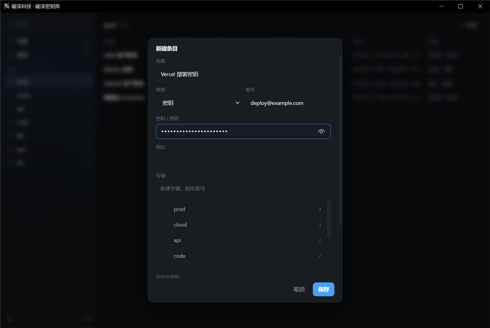

# 璇泽密钥库 · Xuanze Password Manager

[](LICENSE)
[](https://www.rust-lang.org/)
[](https://tauri.app/)
[]()
[]()

**A fast, local-first password manager for Windows.**
Rust core + Tauri v2 shell. Argon2id + AES-256-GCM. No cloud, no account,
no telemetry — everything stays on your machine and is bound to it.

> 一个**轻量、极快**的本地密码管理器，面向日常使用。Rust 核心 + Tauri v2 桌面壳。
>
> 打开要快、搜到要快、复制要快、锁上要快。同时该有的安全一点不打折。
>
> 网站密码、API 密钥、访问令牌、数据库口令、SSH 私钥，都放这一个文件里。

---

## 这是什么，不是什么

先说清楚位置，省得期待错位。

**它是给个人日常用的。** 装在自己电脑上，双击打开，输一次密码，找到要的东西，
复制，切回原来的窗口粘上去。整个流程五秒内结束。浏览器自带的密码管理器
管不了 API key、数据库口令、SSH 私钥；笔记软件存这些等于明文摊在桌面。
这个产品填的就是这个空档。

**它主打快和小。** 安装包 2 MB，装完 5 MB，冷启动不到一秒。
同样的事，Electron 那一套要 100 MB 起步。这个差距不是省硬盘，
是「点开它」这个动作本身没有心理负担 —— 你才会真的去用它。

**它也能用于工作。** 存生产环境的密钥、服务器凭据没问题，加密强度和
本地文件格式都够。但它不是团队协作工具：没有共享库、没有角色权限、
没有审计日志。一个人用，或者一个人管自己的那一摊，这是它的射程。
团队场景需要的那些东西不在这里，也不会假装有。

**它不是「零信任堡垒」。** 防的是「文件被拷走」「U 盘丢了」「电脑被人翻」。
不防「你的电脑已经被攻陷」—— 那一步输了，任何本地密码管理器都救不了你。
下面「安全模型」那节把这条线画得很清楚，请把那几行看完再决定要不要用。

---

## 界面

下面这些图都是从真实软件里截的，不是画的原型图。

### 锁屏

打开软件第一眼看到的就是这个。一个输入框，输密码，进库。

中间那行小字平时是空的，有情况才冒出来——比如「密码不对」，
或者你出门忘了锁，「闲置超时，已自动锁定」也会写在这儿。
底下那句是提醒：密码不上传，忘了就真找不回来了，我们也没有后门帮你重置。

背景那片青色和紫色的光斑会慢慢漂，不快，就是让静止的画面别那么死。


### 主界面

左边一列是专辑，右边是表格。所有条目摊开在一张表里，名称、类型、账号、
密钥、网址、专辑，横向一排，眼睛从上往下扫一遍就够了。

这里跟多数密码管理器不一样的地方：它们通常给你「列表 → 点进详情 → 编辑」三步。
我们直接省掉后两步——数据本来就是表格形状的，摊开看最快。
想改哪一格，点那一格就改。

左边专辑是从标签自动长出来的。你给条目打上 `prod`，`prod` 就出现在左边，
不用提前建目录，也不用纠结它该放哪个文件夹。


### 查看密钥

密码平时是 `••••••`。点眼睛，那一格当场变成明文。

注意只有这一格变了，别的行一动没动。有些软件点「显示」会整个列表重排一遍，
眼睛会跟着跳一下，很难受。


### 按专辑筛选

点左边的 `prod`，右边就只剩打了 prod 标签的 4 条。

上边那条横线写着「prod　4 条」，告诉你现在在哪、还剩多少。
再点「全部」就回来了。


### 搜索

输了「Key」，出来两条：Docker Registry 和阿里云 AccessKey。

搜索不看大小写，也不要求你连着打。输 `ol` 就能找到 `OpenAI`，
因为 `O` 和 `L` 在名字里按顺序出现。名称、账号、网址、标签、备注，全都查。

这儿的想法很简单：你记得的往往不是全名，是「那个带 openai 的」，
所以宁可多搜出来几条，也别让你一个字一个字打全。


### 新建条目

名称、类型、账号、密钥、网址、专辑，一行行填下来。

类型选一下——登录、密钥、凭据、笔记、银行卡，不同东西存的地方不一样。

专辑那栏可以直接新建，输完按回车就有。下面还能加自定义字段，
放什么都行，比如「二步验证方式」「bucket 名」「服务器端口」。
标成敏感的字段会跟密钥一样加密。



### 设置

就四项，没别的：主题、主密码、退出登录、关于。

改主密码要输原密码，改完之后旧密码立刻失效，整个库用新密码重新封一遍。
界面里那句「数据用新密码重新封装」不是客套话，是真的全量重加密。


### 浅色主题

深色是纯黑，浅色是纯白，两边都不透背景。

为什么不透？因为这是看数据的地方。底下要是流光溢彩，读起来会累。
光斑只留在左边专辑栏和锁屏，那边不需要盯字。


### 第一次用

第一次打开没库，就让你设个密码。

只输一次不够，要输两遍，两遍一样才放行。密码至少 8 位。


---
## 为什么做这个

日常要记的东西早就不是「网站密码」了：

- 十几个云厂商的 AccessKey / SecretKey
- 一堆服务的 API token（OpenAI、GitHub、Stripe、各种 SaaS）
- 数据库连接串、SSH 私钥、证书私钥
- 还有那些「三个月用一次、用的时候想不起来」的旧账号

浏览器自带的密码管理器管不了这些；笔记软件存密钥又等于明文。所以就有了这个库。

**核心取舍：一切围绕「便捷」和「快」。** 打开要快、搜到要快、复制要快、锁上要快。

---

## 特点

| | |
|---|---|
| **快** | 1 万条条目，搜索 < 1 ms，取密钥 44 ns，打开 56 ms（含 64 MiB Argon2） |
| **小** | Tauri 壳，安装包 MB 级，不是 Electron 的 100 MB |
| **安全默认** | Argon2id + AES-256-GCM + HKDF 子密钥隔离，密钥材料全量 zeroize |
| **格式公开** | 完整二进制格式规范（[docs/FORMAT.md](docs/FORMAT.md)），可自行实现读取器 |
| **本地** | 不联网、不注册、不上传。vault 就是一个文件，扔 U 盘就能带走 |

---

## 快捷操作

| 操作 | 说明 |
|---|---|
| `Ctrl+K` | 聚焦搜索框 |
| `Ctrl+N` | 新建条目 |
| `Enter` | 复制选中条目的密钥 |
| `↑` `↓` | 在列表里上下移动选中 |
| `Ctrl+Shift+1…9` | 直接复制热度榜第 N 条的密钥 |
| `Ctrl+L` | 立即锁库（擦除内存中的密钥与明文） |
| `Esc` | 关闭弹窗 |

输入框内不触发以上快捷键。

另外两项自动行为：闲置超时自动锁库；复制的密钥在剪贴板里停留固定时长后自动清除。

---

## 项目结构

```
.
├── crates/
│   ├── xz-core/      核心库：格式、加密、KDF、索引、搜索、内存擦除
│   ├── xzc/          命令行工具：不装 GUI 也能用
│   └── xz-bench/     性能基准
├── src-tauri/        桌面壳（Tauri v2 命令层 + 自动锁定 + 剪贴板）
├── src/              前端界面（原生 TS，无框架）
└── docs/
    ├── FORMAT.md       二进制格式规范（规范来源）
    ├── PERFORMANCE.md  性能报告与优化过程（含被回退的尝试）
    └── screenshots/    界面截图
```

## 构建

```bash
# 只跑核心库测试（不需要 Tauri 环境）
cargo test -p xz-core

# 性能基准
cargo run --release -p xz-bench

# 命令行
cargo run --release -p xzc -- --help

# 桌面应用（需要 WebView2 与 Tauri CLI）
cargo tauri dev
cargo tauri build
```

## 命令行速览

```bash
xzc init   my.xzvlt --password -
xzc add    my.xzvlt --password - --name "OpenAI 生产 Key" --kind api-key \
                          --secret sk-xxxx --tag api --tag prod
xzc find   my.xzvlt --password - openai
xzc show   my.xzvlt --password - <id> --reveal
xzc export my.xzvlt --password - --out backup.csv
```

`--password -` 表示从环境变量 `XZ_PASSWORD` 读取，避免密码进 shell 历史。

> **注意：`xzc` 建的库和桌面端的库不通用。**
>
> 桌面端建库时，主密钥派生混入了本机 DPAPI 封存的随机串（机器绑定）；
> `xzc` 不绑定机器，派生材料不同。两者算出来的密钥不一样，
> 所以谁建的库谁来开，互相打不开。
>
> 这是有意为之：`xzc` 的定位是「不进 GUI 也能读写、能复现格式问题」，
> 不是桌面端的第二入口。真要把一个库在两个端之间搬，只能走导出 CSV 再导入。

---

## 安全模型（说清楚边界）

**防的：**

- 磁盘上被拷走 → 没有主密码打不开（Argon2id 64 MiB + AES-256-GCM）
- 文件被篡改 → 头参与 AAD，任一位改动都会认证失败
- 拷到别的机器上爆破 → 主密钥派生混入了本机 DPAPI 封存的随机串，
  换个环境解不开；而且只认本机建的那个库，外来文件连试密码的机会都不给
- 密码泄漏到日志 → 所有密钥材料走 `SecretBytes`，`Debug` 只打印长度
- 内存残留 → `zeroize`，锁库时主动擦除
- 从界面打开开发者工具 → 发布版编译期就没有 devtools 能力，
  另外拦了 F12 / `Ctrl+Shift+I` / `Ctrl+U` / 右键菜单

**不防的：**

- 主密码本身被录屏 / 键盘记录
- 已提权的本地恶意软件读进程内存
- 用户把导出的 CSV 明文留在桌面
- **解锁后的 12 小时内，主密码不再是唯一的钥匙。** 见下一条。

### 关于「解锁票据」

这是设计里最需要讲明白的一处，因为它的安全含义经常被误解。

每次解锁成功，程序会把主密钥用 **Windows DPAPI** 封存到
`%APPDATA%\cn.xuanze.vault\unlock.ticket`，有效期 12 小时。
这段时间内再次打开，跳过 Argon2id，几毫秒就进。

**这等于什么：** 在这个窗口期内，进入这个库靠的是「你现在是这个 Windows 用户」，
而不是「你记得主密码」。

**这不等于「主密码失效」。** DPAPI 是用户级加密，要解开票据，攻击者得先拿到
你这个 Windows 用户的身份。也就是说攻击面从「拿到那个 .xzvlt 文件」
变成了「攻陷这台机器上你的账户」—— 后者本来就已经是硬伤了，见上面「不防的」第二条。

**这是一次自觉的取舍。** 那 1.5 秒的 Argon2id 每次都要等，会让人不想用这个软件；
而一个不想用的密码管理器，安全性等于零。所以用「本机用户身份」换掉了
「每次都算一遍密码」。

**要更严的话：** 解锁票据是一个独立机制，删掉 `machine.rs` 里的
`save_ticket` / `load_ticket` 两个函数，程序就退回「每次打开都完整跑 KDF」。
没有开关，但改动只有一处。

这类工具的上限就在这。写进 README 比藏在文档里诚实。

---

## 状态

**v1.0.0** —— 格式、核心库、桌面壳都已稳定。54 项单元测试全绿，
`cargo clippy` 干净，安装包 2 MB 可正常安装运行。

**能用的：** 建库、解锁、增删改查、搜索、专辑筛选、复制、自动锁定、
改主密码、深色/浅色主题、导出 CSV/XLSX、命令行工具 `xzc`。

**还没有的：** 全局热键（在任意程序里一键唤出）、浏览器扩展、
移动端、云同步。这些在 [ROADMAP.md](docs/ROADMAP.md) 里，不承诺时间。

开发过程中实测发现并已修复的几个界面问题，记在这里免得别人再踩：

1. **WebView2 在高 DPI 下把窗口尺寸当成物理视口**，150% 缩放时页面只填满窗口的 2/3。
   修法见 `src-tauri/src/lib.rs` 的 `setup`。
2. **模态框底部的保存按钮会被顶出可视区**，因为 `.modal` 自己滚又限高。
   改成头/脚固定、只有主体滚（`src/style.css`）。
3. **新建库后没有立即落盘**，用户关窗口就丢数据。现在建库成功立刻保存。
4. **Tauri 的同步命令在主线程执行**，建库那 1.5 秒 Argon2 会把窗口冻住，
   Windows 弹出「程序未响应」。改成 `async` + `spawn_blocking`。
5. **`z-index` 漏了就让背景层盖住整个界面**，表现是「纯色背景不生效」。
   `#app` 必须建独立层叠上下文。

---

## 构建注意

`cargo build` 直接编会在二进制里留下 dev URL（`tauri-build` 只要看到 `tauri.conf.json`
有 `devUrl` 就设 `cfg(dev)`，与构建 profile 无关）。正式构建请走 Tauri CLI 并覆盖配置：

```bash
cargo tauri build --config '{"build":{"frontendDist":"../dist","devUrl":null}}'
```

## 许可

**PolyForm Noncommercial 1.0.0**。见 [LICENSE](LICENSE)。

简单说：源代码开放，你可以自由查看、修改、自己使用，用于个人学习、研究、
非营利组织都没问题；**但不得用于商业用途**，也不能把修改后的版本当商业产品
分发或销售。

为什么要开源：密码管理器的安全性不该建立在「相信作者」之上。算法、密钥派生、
文件格式全部可查、可审、可复现——这样安全性才是能被验证的，而不是被宣称的。
