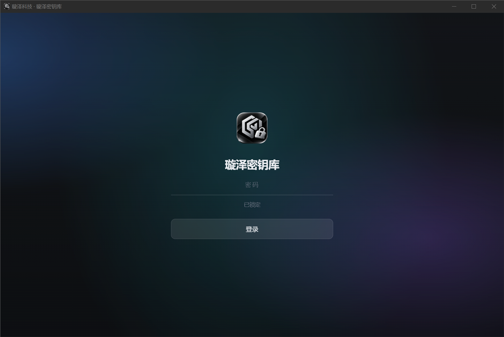
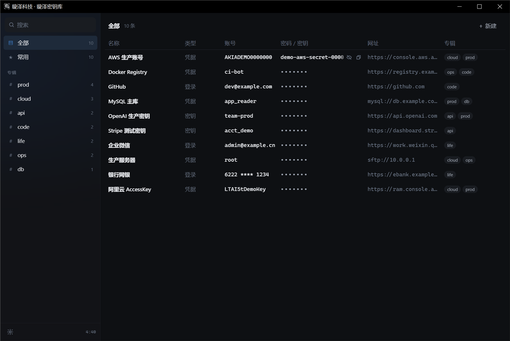
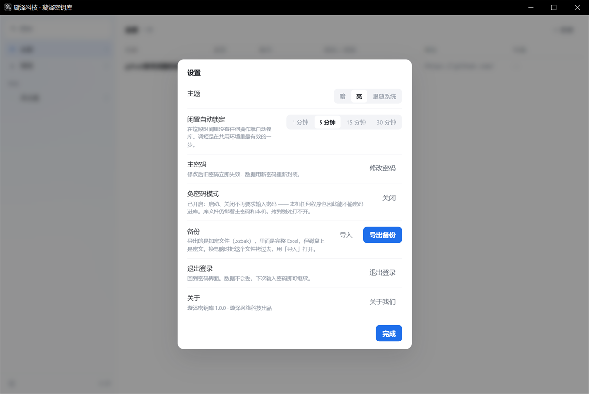
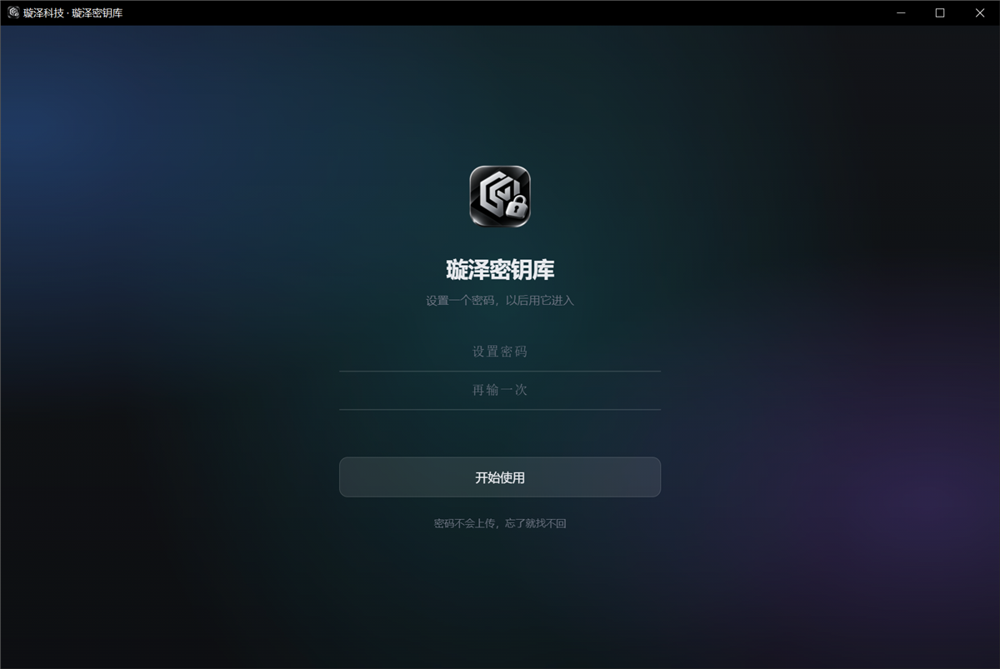

# 璇泽密钥库 · Xuanze Password Manager

[](LICENSE)
[](https://www.rust-lang.org/)
[](https://tauri.app/)
[]()
[]()

**A local-first password manager for Windows.**
Rust core + Tauri v2 shell. Argon2id + AES-256-GCM. No cloud, no account, no telemetry.
Vaults are bound to the machine's hardware, and backups are encrypted containers
rather than plain spreadsheets.

---

## 这是什么

先说清楚这是什么。璇泽密钥库是璇泽网络科技开发的一款本地密码管理器，用来存放
网站密码、API 密钥、访问令牌、数据库口令和 SSH 私钥。它跑在你自己的电脑上，
不联网、不上传、不收集任何东西。

装好之后设一个主密码就能开始存东西，没有注册流程，没有订阅，也没有工作区
之类的概念 —— 打开就是库。

日常用起来大概是这个节奏：打开、输密码、找到条目、复制、切回原来的窗口粘贴。
五秒钟走完。浏览器自带的密码管理器存不了 API 密钥和 SSH 私钥，笔记软件存这些
又等于把明文摊在桌面上，我们想补的是这一段。

便捷性在这个产品里排得很靠前。打开和搜索都在毫秒级，复制一条密钥是纳秒级 ——
这些数字下面会列。同时安全性按真实的威胁模型做取舍，哪些挡得住、哪些挡不住，
都会写出来。

1.0.0 里已经可用：建库、增删改查、搜索、专辑分类、自动锁定、改主密码、
深浅主题、加密备份、过期提醒。

> **有一件事得放在前面说：库文件绑硬件。**
>
> `vault.xzvlt` 只能在这一台硬件上打开。换主板、换系统盘、换电脑都打不开，
> 密码正确也不行 —— 这是刻意的，它挡的是「文件被拷走」这一类事故。
>
> 重装系统、格式化 C 盘、清空 `%APPDATA%`、改计算机名，都不影响。
> 绑定材料跟着文件走，系统装好之后把文件放回原处就能打开。
>
> 备份同样是密文。「导出备份」得到的是 `.xzbak`：里面是完整 Excel，
> 外面用 Argon2id + AES-256-GCM 封着，磁盘上不出现明文表格。
>
> ```text
> 备份：设置 → 备份 → 导出备份
> 迁移：新机器上建好库 → 设置 → 备份 → 导入 → 选那个 .xzbak
> ```
>
> 建议每月导出一次，重要改动之后再补一次。完整流程见
> 「[备份与迁移](#备份与迁移加密备份这条路线)」。
>
> **还有一条边界得放在前面：库解锁期间，本机同一 Windows 账户下的任何程序
> 都能读到明文。** 这是 Tauri IPC 不校验调用方的直接结果，所有本地密码管理器
> 都有类似前提。我们把能收紧的地方收了（见「[安全](#安全)」一节），
> 但这个前提本身没变。

---

## 它管什么

能存的东西大致是这几类：网站密码，API 密钥和访问令牌，数据库连接串，
SSH 私钥和证书，银行卡信息，以及那些用得不多但丢不起的账号。

这些内容全部落在同一个加密文件里。每条可以带若干自定义字段 —— 比如
「二步验证方式」「bucket 名」「服务器端口」这类放不进固定栏位的东西。
单条最多 512 个字段，每个值 64 KiB。

标成敏感的字段会按主密钥级别加密，界面上默认打码，单独点开才显示。
导出备份时它们以明文写进表格 —— 导出本来就是全量，这一点绕不开，
所以备份密码要设好。

---

## 它有多快

下面这些数字都是在本机实测的，测量方法和原始数据在
[docs/PERFORMANCE.md](docs/PERFORMANCE.md)。

| 指标 | 实测 |
|---|---|
| 安装包 | 2.1 MB |
| 装完占用 | 约 5 MB |
| 解锁（含 KDF） | 0.5–0.8 秒 |
| 打开 1 万条（净解析） | 39 ms |
| 搜索 1 万条 | 1 ms 内 |
| 取一条密钥 | 44 ns |
| 保存 1 万条 | 65 ms |

体积和启动时间主要省在架构上：核心用 Rust 直接编译成机器码，界面复用系统自带
的 WebView2，没有打包浏览器内核。一个不需要犹豫就能点开的密码管理器，
才会被真正用起来。

---

## 安全

安全这一节分四块：文件离开这台电脑之后还剩多少保护，什么情况打得开、
什么情况打不开，备份是怎么加密的，最后一张防与不防的清单。

### 库文件离开这台电脑之后

第一道防线是密钥派生绑定本机。这一层最容易被高估，得先把它说清楚。

除主密码外，派生还混入一段 32 字节随机串（256 bit，`BCryptGenRandom` 生成）。
这段材料在文件里带一份，用主板 SMBIOS UUID 派生的密钥加密。所以攻击者手里
有什么，决定了还剩多少工作要做：

| 攻击者手里有什么 | 结果 |
|---|---|
| 只有 `vault.xzvlt` | 解不开：缺那 32 字节，文件里的密文块打不开 |
| 文件 + 那台机器的 SMBIOS UUID | 能解出那 32 字节，接着面对主密码 + 一次 Argon2id |
| 再加上一个弱主密码 | 真正危险的组合 |

UUID 不是秘密。`Get-CimInstance Win32_ComputerSystemProduct | Select UUID`
一行就能读，系统信息、资产台账、硬件报告、日志里都可能有。所以这一层提高的
是门槛，没把路堵死 —— 它要求攻击者先知道那是哪台机器。

早期版本用的是 DPAPI 封存的 `machine.bind`，加上机器名与卷序列号。那条路
更难打穿，但重装一次系统，数据就永久报废。1.0.0 把材料搬进了文件，
换来重装不丢数据，代价就是上表第二行。

第二道是 Argon2id 加 AES-256-GCM。拿到那 32 字节之后，攻击者仍然要爆破主密码，
每次约 0.5 秒（256 MiB × 4 轮）。默认档比 Bitwarden 的默认更硬，但这是
「一个正常密码管理器」的强度：文件离开机器并不等于打不开，只是变得不划算。

第三道是库标识登记表。程序拒绝打开未经登记的库文件，挡的是「点错了别人的
`.xzvlt`」和被钓鱼文件误导。它不构成安全边界 —— 登记表本身就在 `%APPDATA%` 下，
有本机写权限的人可以改。我们不算它一道。

### 哪些情况打得开，哪些打不开

把边界摊开来说，大概是这样：

| 发生了什么 | `vault.xzvlt` | 数据 |
|---|---|---|
| 改计算机名 | **能开**（名字不参与绑定） | — |
| 重装系统（同一台机器） | **能开**（绑定材料在文件里） | — |
| 格式化 C 盘重装 | **能开** | — |
| 清空 `%APPDATA%` | **能开** | — |
| 换主板 | 打不开 | 用之前导出的 `.xzbak` 恢复 |
| 换系统盘 + 重装 | 打不开 | 同上 |
| 换电脑 | 打不开 | 同上 |
| 只把 `vault.xzvlt` 备份到网盘 | 那份备份在别的机器上打不开 | 备份要存 `.xzbak` 才有用 |
| 忘了主密码 | 打不开 | 之前导出的 `.xzbak` 仍可导入（输新库密码 + 当时的备份密码） |

库文件不出这台机器，也不接受在别处被还原。这是产品形态，不是待修的缺陷。

选它的理由：密码管理器最常见的失事方式不是算法被破，是备份文件流出去。
一个能在任何机器上解开的库，安全性上限等于主密码的强度，跟你把文件发给谁无关。
我们不想把产品的安全压在这一个变量上。

代价是换硬件之后必须主动做一次「导出 → 导入」。这笔账要不要付，看三条：

1. 这台机器长期使用，不常换、不常重装 —— 那基本不用付
2. 换硬件之前知道要做的是导出一次，而不是备份 `%APPDATA%`
   （那个目录里的材料换机器用不了）
3. 能维持定期导出的习惯，哪怕一个月一次

库文件本身不提供跨硬件恢复，加密备份补的是这一块。导出多少字段，
导入就还原多少字段，含自定义字段与全部时间戳。

### 备份是密文

设置里的「导出备份」会生成一个 `.xzbak` 文件。里面是一份完整的 xlsx
（按专辑分工作表，用 Excel 打得开），外面包了一层我们自己的加密：
Argon2id 64 MiB × 3 派生，加 AES-256-GCM。磁盘上从头到尾不出现明文表格。

我们没用 Excel 自带的密码保护。OOXML 那套（ECMA-376）早就被 hashcat
一类工具跑穿了，几小时到几天的事。这里要保护的是全部账号密码，
不能拿一个已知能跑穿的锁去锁它。

导出时要输两个密码，各有各的用处：

| 密码 | 干什么 |
|---|---|
| 主密码 | 证明操作者是你本人。导出、导入、改密码、开关免密码模式都要它 |
| 备份密码 | 加密这个 `.xzbak`。可以设成和主密码一样，也可以另设 |

备份密码不能留空，留空就等于没加密。免密码模式也不豁免主密码那一步 ——
那个模式省的是每次启动的输入，不该顺带把「一次性拿出全部数据」变成免检。

表格的格式是固定的，导入导出严格对称：

| 位置 | 含义 |
|---|---|
| 每张工作表 | 一个专辑（左侧栏里的那个标签），另有一张「全部」 |
| 第一行 | 表头，共 12 列：名称 / 类型 / 账号 / 密码·密钥 / 网址 / 专辑 / 备注 / 更新时间 / 自定义字段 / 创建时间 / 过期时间 / 使用次数 |
| 列怎么对位 | 按列名对位，不按位置。列顺序可以调、中间可以插自己的批注列，只要「名称」列在 |
| 认不出表头 | 整张表跳过，不去猜列序 —— 猜错会把密码塞进用户名 |
| 自定义字段列 | `字段名=值`，多个用 `; ` 分隔；字段名前的 `!` 表示这个字段是敏感的 |
| 空单元格 | 省略了也不影响 —— 读取按每个单元格自己的地址定位，不会整行左移 |

导入时两种文件都吃：`.xzbak`（要备份密码）和普通 `.xlsx`（直接读，方便别人
给你一份手工整理的表）。「名称 + 账号」都相同的条目会被跳过，同一个文件可以
重复导入。失败的条目会把原因报出来，最多 10 条，不会静默少条。

> **`.xzbak` 里的 xlsx 认的是这套表头。** 从 1Password / Bitwarden 导出的 xlsx
> 认不了，那是它们的列名。需要从别处迁移，先把列名改成上面那 12 个
> （只保留前 9 列也能导入，缺的列按空处理）。用 Excel 打开、改一格、再保存
> 也没问题：文件会变成共享字符串表，读取端认这个。

### 外部工具能读吗

不能，但边界要说清楚。

格式完全公开（[docs/FORMAT.md](docs/FORMAT.md)，可以自己实现读取器），
可是离线读取内容仍然需要主密码和那台机器的硬件标识。格式透明，数据不透明。

这条只对「静置在磁盘上的文件」成立。软件解锁、正在运行的那段时间，前端与
Rust 之间走 Tauri IPC，而 Tauri v2 的 IPC 不校验调用方身份 —— 它假定同一台
机器上的其它进程是干净的。库开着的时候，一个能注入 WebView2 或构造 IPC 请求
的本地进程，可以调用 `entry_reveal` 拿到明文。

这个前提在所有本地密码管理器底下都一样。写出来比略过好：本软件信任
「已登录的这个 Windows 用户」运行的所有程序。

承认这一点之后，几条敏感动作在 IPC 层做了收紧，不依赖界面自觉：

| 动作 | 收紧方式 |
|---|---|
| 导出备份 / 导入 | 必须重新验证主密码，判定方式是重新派生后与内存主密钥做常量时间比对 |
| 改主密码 / 开关免密码模式 | 同上，必须证明知道主密码 |
| 写回库文件 | 路径由后端决定，IPC 上没有路径参数；目标位置已存在别的库或别的文件时拒绝覆盖 |
| 打开库 | 路径同样由后端决定，前端没有「打开哪个文件」的发言权 |
| 改自动锁定时长 | 要求已解锁。锁着的时候把时长拉长，等于替下一个人关掉一把锁 |

要改掉「同账户程序可信」这个前提，需要 IPC 层的身份挑战机制（一次性 token），
当前版本没有做。环境本身就不可信的时候（共用电脑、来源不明的软件多），
把闲置锁定调到 1 分钟，用完立刻锁定。

### 防什么，不防什么

| 威胁 | 处理 |
|---|---|
| 库文件被拷走 | 主密码之外还缺那 32 字节绑定材料 |
| 文件被篡改 | 71 字节文件头整体作为 AAD，任一位改动导致认证失败 |
| 换硬件后离线爆破 | 绑定材料用主板身份封装，换板/换盘解不开。知道那台机器的 SMBIOS UUID 就能解开，见上文 |
| 备份文件泄露 | 导出即加密（Argon2id 64 MiB × 3 + AES-256-GCM），磁盘上没有明文表格 |
| 敏感数据进入日志 | 密钥材料统一走 `SecretBytes`，`Debug` 只输出长度 |
| 内存残留 | `zeroize` 全量清零，锁库时主动擦除；导出的明文表格在内存里逐格擦 |
| 通过界面开启开发者工具 | 发布版编译期不含 devtools；另拦截 F12、`Ctrl+Shift+I`、`Ctrl+U` 与右键菜单 |
| 剪贴板长期驻留 | 敏感内容 15 秒、普通内容 60 秒后自动清除；校验指纹避免误清用户内容；清除失败会保留指纹重试 |
| 误建新库覆盖旧库 | 「本机有没有库」问后端（登记表 + 文件存在）；后端保存前再挡一道：目标是别的库时拒绝写入 |
| 恶意 Excel | 单个 zip 成员解压上限 64 MiB；自定义字段列与段数设上界；行数上限 20 万 |
| 畸形库文件 | 逐字节篡改、长度字段极值、全长度截断、随机字节都有测试守着；任何路径只返回错误，不 panic |
| 超大库文件 | 打开前先查大小，超过 1 GiB 直接拒绝 |

不在防护范围内的有四类。主密码被录屏或键盘记录；已经拿到管理员权限的进程
读取内存；开启免密码模式之后，本机进入库不再需要主密码（备份导出仍要求输密码）；
以及删除条目之后，旧密文可能还留在磁盘空闲区 —— 保存是整份重写加替换文件，
旧数据块交给系统回收，本软件不做磁盘擦除。磁盘会落到别人手里的话，
应该对整盘启用 BitLocker，而不是指望本软件抹掉痕迹。

还有一处值得单独说，因为它和这个项目别处的严格程度不太一致：**你输入的主密码
从输入框传到 Rust 的路上，会经过一段 JavaScript 字符串。** `invoke` 的参数要
被 `JSON.stringify` 序列化，那份明文副本在 JS 堆上没法 zeroize，只能等 GC。
这是 WebView 架构的固有代价 —— Tauri 和 Electron 的密码管理器都躲不开。
Rust 侧收到之后立刻放进 `SecretBytes`，能擦的都擦了；JS 这一段擦不掉。

### 免密码模式

设置里有一个开关，默认关闭。

打开之后，在这台电脑上启动、关闭都不再要求输入密码。关掉之后一切恢复原样，
每次启动都要输主密码。

它不是「把主密码改成空」。库文件本身没有任何变化，仍然用完整主密码加本机绑定
加密。开启的时候做的是三件事：你输一次主密码通过验证；主密钥用 Windows DPAPI
封存，写到 `%APPDATA%\cn.xuanze.vault\auto_unlock`；下次启动时程序用 DPAPI
解开这份封存，直接拿主密钥开门。所以边界是这样：

| 场景 | 结果 |
|---|---|
| 这台电脑、这个 Windows 账户 | 直接进，不问密码 |
| 换成别的 Windows 账户 | DPAPI 解不开，退回要密码 |
| 库文件拷到别的电脑 | 打不开（主密码 + 硬件绑定都没变） |
| 把 `auto_unlock` 一起拷走 | 还是解不开（DPAPI 绑账户，不认文件搬家） |
| 重装系统 | 封存丢了，退回要密码（库本身还能开） |
| 关闭免密码模式 | 删掉封存，下次必须输密码 |

为什么绕这一道，而不是直接把密码去掉：一个能随手复制、任何人拿到都能开的库，
本质上已经不是加密文件了。免密码模式解决的是「每次输入很烦」，不是「不要密码」。
这两件事用同一个办法解决，会把前者一起毁掉。

代价写在明处。封存在本机的主密钥，同一个 Windows 账户下的任何程序都能解开。
开启期间，本机任何程序都能不输密码进你的库 —— 启动时那道「证明你是你」的门槛
在这台机器上撤掉了。这是模式的直接后果，不是遗漏。所以开启前有一次勾选确认。

另外还有两条连带规则：备份导出和导入仍然要求输入主密码，一个把全部数据拿出来、
一个往库里写数据，不跟着这个开关放行；改主密码会自动关闭免密码模式，
旧密钥失效，需要重新开启一次。

想要「打开就能用」又不想撤掉本机门槛的话，把闲置锁定调短比开这个模式划算。

---

## 用起来是什么样

下面这些图都是从软件里直接截的，不是画的原型图。

### 锁屏

打开软件第一眼看到的就是这个。一个输入框，输密码，进库。

中间那行小字平时是空的，有情况才冒出来 —— 比如「密码不对」，或者你出门
忘了锁，「闲置超时，已自动锁定」也会写在这儿。底下那句是提醒：密码不上传、
只存在这台电脑上；忘了密码只能靠导出的备份恢复数据，所以建议尽早导出一次。

背景那片青色和紫色的光斑会慢慢漂，不快，只是让静止的画面别那么死。



### 主界面

左边一列是专辑，右边是表格。所有条目摊开在一张表里，名称、类型、账号、密钥、
网址、专辑横向排开，眼睛从上往下扫一遍就够了。

多数密码管理器给你「列表 → 点进详情 → 编辑」三步。我们省掉「点进详情」这一步 ——
数据本来就是表格形状的，摊开看最快。选中一行可以直接按 `Enter` 复制密钥；
要改内容点行尾的铅笔图标，或者在空窗里按 `Ctrl+N`。

左边那些专辑是从标签自动长出来的。你给条目打上 `prod`，`prod` 就出现在左边，
不用提前建目录，也不用纠结它该放哪个文件夹。


### 查看密钥

密码平时显示成 `••••••`。点一下眼睛，那一格当场变成明文。

注意只有这一格变了，别的行一动没动。有些软件点「显示」会整个列表重排一遍，
眼睛跟着跳一下，很难受。



### 按专辑筛选

点左边的 `prod`，右边就只剩打了 prod 标签的 4 条。

上边那条横线写着「prod　4 条」，告诉你现在在哪、还剩多少。再点「全部」就回来了。


### 搜索

输「Key」，出来两条：Docker Registry 和阿里云 AccessKey。

搜索不看大小写，也不要求你连着打。输 `ol` 就能找到 `OpenAI`，因为 `O` 和 `L`
在名字里按顺序出现。查的是名称、账号、网址、标签这四项。

备注不参与搜索，这是有意的。备注里经常粘着私钥正文、恢复码、「数据库口令是 xxx」
这种话，把它塞进常驻内存的索引，等于让最敏感的那部分内容变成可检索的明文结构。
索引里只有名称、账号、网址、标签，别的进不去，有单测守着。


### 新建条目

名称、类型、账号、密钥、网址、专辑，一行行填下来。

类型选一下 —— 登录、密钥、凭据、笔记、银行卡，不同东西存的地方不一样。
过期时间可以设，也可以留空表示不过期；到期之后列表里的名字旁边会标「已过期」，
导出的表格里也带这一列。

专辑那栏可以直接新建，输完按回车就有。下面还能加自定义字段，放什么都行，
比如「二步验证方式」「bucket 名」「服务器端口」。标成敏感的字段会跟密钥一样加密。


### 设置

一共七项，没有藏起来的开关：主题、闲置自动锁定、主密码、免密码模式、备份、
退出登录、关于。

闲置锁定在 1 / 5 / 15 / 30 分钟之间选，默认 5 分钟。改完立刻生效，也存得住 ——
设置存在后端，清一次 WebView 数据不会把它冲掉。

改主密码要输原密码，改完之后旧密码立刻失效，整个库用新密码重新封一遍。
界面上那句「改完之后旧密码立即失效」不是客套话，是真的全量重加密。

免密码模式和备份这两项的详细规则在前面「安全」一节里，这里不重复。



### 浅色主题

深色是纯黑，浅色是纯白，两边都不透背景。

为什么不透？因为这是看数据的地方。底下要是流光溢彩，读起来会累。光斑只留在
左边专辑栏和锁屏，那边不需要盯字。


### 第一次用

第一次打开没有库，就让你设个密码。

只输一次不够，要输两遍，两遍一样才放行。密码至少 8 位。



---

## 快捷键

| 操作 | 说明 |
|---|---|
| `Ctrl+K` | 聚焦搜索框 |
| `Ctrl+N` | 新建条目 |
| `Enter` | 复制选中条目的密钥 |
| `↑` `↓` | 在列表里上下移动选中 |
| `Ctrl+Shift+1…9` | 直接复制热度榜第 N 条的密钥 |
| `Ctrl+L` | 立即锁库（擦除内存中的密钥与明文） |
| `Esc` | 关闭弹窗 |

输入框内不触发以上快捷键。

另外两项自动行为：闲置超时自动锁库（时长可在设置里调，1 到 30 分钟）；
复制的密钥在剪贴板里停留 15 秒后自动清除。

---

## 几个常被提出的问题

产品公开之后收到过一些批评，其中几条判断成立，也有几条把风险估高了。
这里逐条回应，你可以自己去代码里核对。

**「机器绑定不增加熵，所以是无效的。」**

前半句对，后半句错。那 32 字节是 `BCryptGenRandom` 生成的，做字典攻击
无从下手。硬件标识（早期用机器名与卷序列号，现在用主板 SMBIOS UUID）
不贡献熵，它防的是那份材料被挪用到别的机器上。强度来源是主密码加上
256 bit 随机串，不是主密码加上机器名。

真正成立的说法是另一句：这层挡不住能在你的 Windows 账户下运行代码、
并且知道你机器硬件标识的人。这一点上文已经写明。

**「既然要定期导出，硬件绑定就是多余的。」**

两者防的不是同一件事，见「[备份与迁移](#备份与迁移加密备份这条路线)」一节。
硬件绑定防的是文件被动带走，备份是你主动留一份。而且从 1.0.0 起，
导出的东西本身也是密文，备份不会再制造一个新的明文副本。

**「这只是在用安全感换可用性风险。」**

可用的替代方案是不绑定硬件，代价是任何拿到 `.xzvlt` 的人，都能在自己的机器上
不限时间、不限次数地离线爆破主密码。对一个主密码可能是「名字 + 生日」的
现实用户群来说，那才是更大的风险。

**「作为日常个人密码库不建议。」**

要分清这句话说的是哪一层。如果指的是怕丢数据，那是备份问题，加密备份就是
为它准备的；如果指的是换硬件不方便，那是产品形态，这篇文档从头到尾都在说
这件事。

我们不假装它适合所有人。需要跨设备、需要异地容灾的人应该用 KeePass 或
Bitwarden。但「换硬件不方便」不等于「不能日常用」，这两件事经常被混在一起说。

**「导入导出会丢自定义字段。」**

这条曾经成立，已经修掉了。上一版导入时只读前 7 列，自定义字段被丢弃，
创建时间和过期时间也会重置 —— 那确实是缺陷，不是取舍。

现在导出 12 列、导入按列名对位，自定义字段（含敏感标记）用可逆编码，
带 `!` 前缀与 `\` 转义，往返一次逐字段相等。这一点有测试盯着：
`entry_survives_export_then_import` 把一条带自定义字段、三个时间戳、
使用次数的条目走完整条「表格 → 条目」的路，逐个字段比对。跟它一起修的还有三条：
用 Excel 改一格再保存不会串列（按单元格地址读，认共享字符串表）；
导入失败不再静默（带行号和原因报出来）；编辑条目不会再清空敏感自定义字段
（前端拿不到敏感值，空串按「用户没碰」处理，不是「清空」）。

---

## 备份与迁移：加密备份这条路线

这是这个产品唯一的用户侧备份方案，也是备份功能存在的首要理由。
完整手册在 [docs/BACKUP.md](docs/BACKUP.md)，含字段级别的还原清单和常见误区。

建议每月导出一次，重要改动之后再补一次，并保留最近几份。

### 日常备份

```text
设置 → 备份 → 导出备份
  ↓
输主密码（证明是你）+ 设一个备份密码（给这个文件上锁）
  ↓
选一个位置（移动硬盘、U 盘、网盘都行）
  ↓
得到一个 .xzbak —— 密文，2 MB 上下
```

有三点要知道。文件本身是密的：里面是完整 Excel，外面用 Argon2id 加
AES-256-GCM 包了一层，拿到文件的人没有备份密码，看到的是一堆随机字节。
备份密码别忘：忘了它这个文件就打不开，我们也没有后门 —— 可以设成和主密码一样
（少记一个），也可以另设一个（一处泄露时影响面小些）。

第三点是它的分量：换硬件只能靠它。硬盘坏了、换电脑、换主板，只要这份 `.xzbak`
还在，数据就能通过导入原样回来；反过来说，没有它就没有第二条路。

### 换硬件或换电脑：三步

全程在界面上点，不需要命令行，也不用碰 `%APPDATA%`。

| 步骤 | 在哪 | 做什么 |
|---|---|---|
| 1 | 旧机器 | 设置 → 备份 → 导出备份。把 `.xzbak` 拷到新机器 |
| 2 | 新机器 | 装好软件，第一次打开照提示设主密码 —— 这会建一个新库 |
| 3 | 新机器 | 设置 → 备份 → 导入，选那个 `.xzbak`，输新库的主密码加当时的备份密码 |

导入会还原这些：名称、类型、账号、密码·密钥、网址、专辑、备注、
自定义字段（含敏感标记）、创建时间、更新时间、过期时间、使用次数。
不还原的只有一样：库本身。新库有新的库标识、新的硬件绑定、新的文件，
旧的 `vault.xzvlt` 迁移完之后就不需要了（它是绑定旧硬件的密文，留着也打不开）。

> **如果只是重装系统（硬件没换），不需要走这三步。** 绑定材料就存在文件里，
> 系统装好、软件装好、把 `vault.xzvlt` 放回 `%APPDATA%\cn.xuanze.vault\`
> 就能直接打开，连导入都不用。

### 主密码忘了

导出过的 `.xzbak` 仍然可以导入到新库：导入时输的是新库的密码，加上你当初设的
备份密码。所以忘了主密码不等于数据没了，前提是导出过。没导出过就真的没有了，
我们没有任何后门可以恢复。

> 有人会问：既然有导出，为什么还要硬件绑定？
>
> 因为两者防的不是同一件事。硬件绑定防的是库文件被动带走 —— 网盘误同步、
> U 盘丢失、发错文件，这类事故不需要攻击者做任何事。导出是你主动、明确、
> 知道自己在做什么地把数据拿出来，而且拿出来的还是密文。
> 一个是防意外，一个是做备份，不冲突。
>
> 想把日常体验做到「不用输密码」又保留库文件的高保护，用设置里的免密码模式。
> 它封存的是本机可解的主密钥，不改变库文件本身的加密强度（代价见上文那一节）。

---

## 适用与不适用

### 日常个人使用：可以，这是设计目标

一个人的密码、API 密钥、凭据，由一个人保管和使用。这是唯一的场景，
也是所有取舍的出发点。

装完即用，搜索一万条一毫秒内，复制密钥 44 纳秒。不用理解任何一个密码学名词
也能用起来。前提是接受库文件只在这台硬件上 —— 数据本身可以走
「导出备份 → 导入」搬走，所以日常用不需要惦记换机；真正要养成的习惯只有一个，
定期导出。

### 技术能力与许可授权，是两件事

技术上，加密强度和文件格式足以存放生产环境的密钥。AES-256-GCM、Argon2id、
71 字节 AAD、零内存残留 —— 这些不看使用场景。

许可上，PolyForm Noncommercial 1.0.0 不允许商业用途，而且 Noncommercial
覆盖你所在的组织。换句话说：在公司电脑上安装它、用它存公司的密钥或凭据，
属于违反许可，需要单独购买授权。

技术上能做的，许可上不一定允许。这一条请按许可来，不按技术来。
另外这个产品也不具备团队协作能力：没有共享库，没有角色权限，没有审计日志。

### 明确不做

**云同步与浏览器扩展。** 见 [ROADMAP](docs/ROADMAP.md)。

**不防御已失陷的本机环境。** 攻击者拿到管理员权限就能读进程内存，
任何本地密码管理器都抵御不了。本产品防的是文件被拷走、介质丢失、
设备被他人接触这三类情形。

**项目处于早期，持续维护。** 遇到问题请在
[Issues](https://github.com/XuanzeNetDev/xuanze-password-manager/issues) 提出，
会持续跟进。

---

## 项目结构

```text
.
├── crates/
│   ├── xz-core/      核心库：格式、加密、KDF、索引、搜索、内存擦除
│   └── xz-bench/     性能基准
├── src-tauri/        桌面壳（Tauri v2 命令层 + 自动锁定 + 剪贴板 + 备份封装）
├── src/              前端界面（原生 TS，无框架）
└── docs/
    ├── FORMAT.md       二进制格式规范（规范来源）
    ├── BACKUP.md       备份与迁移：导出与导入的完整流程
    ├── PERFORMANCE.md  性能报告与优化过程（含被回退的尝试）
    └── screenshots/    界面截图
```

## 构建与测试

```bash
# 只跑核心库测试（不需要 Tauri 环境）
cargo test -p xz-core

# 性能基准
cargo run --release -p xz-bench

# 桌面应用（需要 WebView2 与 Tauri CLI）
cargo tauri dev
cargo tauri build
```

**构建注意：** `cargo build` 直接编会在二进制里留下 dev URL —— `tauri-build`
只要看到 `tauri.conf.json` 有 `devUrl` 就会设 `cfg(dev)`，与构建 profile 无关。
正式构建请走 Tauri CLI 并覆盖配置：

```bash
cargo tauri build --config '{"build":{"frontendDist":"../dist","devUrl":null}}'
```

## 当前状态

**v1.0.0**，格式、核心库、桌面壳都已稳定。92 项测试全绿
（核心 69 + 桌面壳 23，含畸形输入、导入导出逐字段往返、v3 绑定块、
加密备份容器），`cargo clippy -D warnings` 干净。

开发过程中实测发现并已修复的几个问题，记在这里免得别人再踩：

1. **WebView2 在高 DPI 下把窗口尺寸当成物理视口**，150% 缩放时页面只填满
   窗口的 2/3。修法见 `src-tauri/src/lib.rs` 的 `setup`。
2. **模态框底部的保存按钮会被顶出可视区**，因为弹窗自己滚又限高。
   改成头脚固定、只有主体滚（`src/style.css` 的 `.panel`）。
3. **新建库后没有立即落盘**，用户关窗口就丢数据。现在建库成功立刻保存。
4. **Tauri 的同步命令在主线程执行**，建库那几秒 Argon2 会把窗口冻住，
   Windows 弹出「程序未响应」。改成 `async` + `spawn_blocking`。
5. **`z-index` 漏了就让背景层盖住整个界面**，表现是「纯色背景不生效」。
   `#app` 必须建独立层叠上下文。

---

## 许可

**PolyForm Noncommercial 1.0.0**，见 [LICENSE](LICENSE)。

简单说：源代码开放，你可以自由查看、修改、自己使用，用于个人学习、研究、
非营利组织都没问题；但不得用于商业用途，也不能把修改后的版本当商业产品
分发或销售。

**注意「商业用途」的界定比直觉宽。** PolyForm Noncommercial 里的
Noncommercial 覆盖你所在的组织：在公司电脑上安装它、用它存公司的密钥或凭据，
也算商业用途，需要单独购买授权。个人自己用、个人项目用都没问题。

换句话说：拿它当私人密码库可以，拿它当公司生产环境的凭据存储不行。

为什么要开源：密码管理器的安全性不该建立在「相信作者」之上。算法、密钥派生、
文件格式全部可查、可审、可复现 —— 这样安全性才是能被验证的，而不是被宣称的。
